<!-- _class: lead -->

# GeoE3
## From Install to Insight

**A 2-hour hands-on workshop**
Run a complete Gender Enabling Environments analysis, start to finish

---

## Today's Agenda

| # | Segment | Time |
|---|---|---|
| 1 | The Interface — open, create a project, the study area grid | 15 min |
| 2 | The Model & Processor Types | 10 min |
| 3 | Getting Data | 10 min |
| 4 | Configuring Items — the one pattern you'll reuse everywhere | 10 min |
| 5 | Contextual Dimension | 10 min |
| 6 | Accessibility Dimension | 10 min |
| 7 | Place Characterization Dimension | 10 min |
| 8 | Running the Analysis (+ stretch break while it runs) | 10 min |
| 9 | Viewing Your Results | 10 min |
| 10 | The Analysis Report | 5 min |
| 11 | Sharing Your Results | 5 min |
| 12 | Wrap-up, resources & Q&A | 5 min |

---

## What We'll Build

By the end of this session, every participant will have:

1. A working QGIS + GeoE3 install
2. A real project, scoped to a study area of their choice
3. At least one fully configured and run dimension
4. A finished **GeoE3 Score** map, a PDF analysis report, and a CSV export

 

> This is a **follow-along** workshop. Keep QGIS open next to the slides
> and do each step as it's demonstrated — don't just watch.

---

## Before We Start — Checklist

> - ✅ QGIS **3.x** installed (3.28 or later recommended)
> - ✅ GeoE3 plugin installed (see pre-session email, or follow along now
>   via **Plugins → Manage and Install Plugins…**)
> - ✅ Internet access (several steps fetch open data on demand)
> - ✅ An empty folder ready to use as your project folder
> - ✅ A rough idea of your study area (a country or region you know)

If any of these are missing, raise a hand now — it's much easier to fix
before we start creating projects.

---

<!-- _class: divider -->

### Segment 1 · 15 min

# The Interface

Open the plugin, create a project, meet the study area grid

---

## Opening the Plugin

Click the **GeoE3** icon in the QGIS toolbar. The panel docks to the
right-hand side of the window.

The first two pages are a short welcome and overview — use the arrow
buttons at the bottom of the panel to move on.

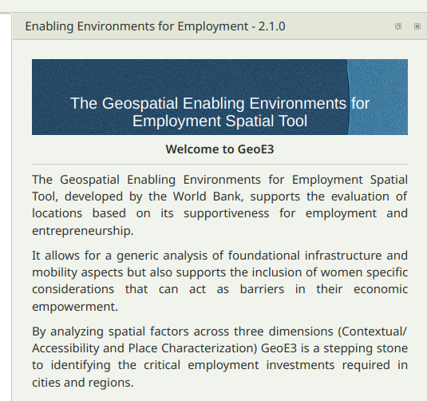

---

## Three Ways Into a Project

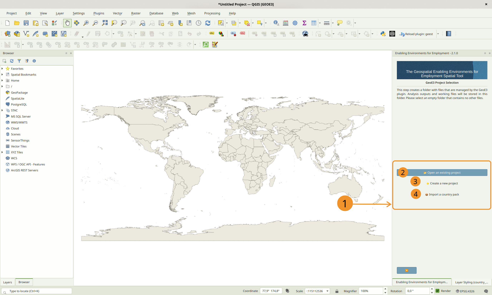

- **Open an Existing Project** — carry on where you left off
- **Create a New Project** — set one up from scratch *(today's path)*
- **Import a Country Pack** — rebuild a colleague's shared project from
  a single GeoPackage

---

<!-- _class: steps -->

## Create a New Project

1. Choose **Create a New Project**
2. Browse to your **empty** working folder
3. Pick a scale: **Regional** (~30 km hex), **National** (1 km), or
   **Local** (100 m) — defaults are a good starting point
4. Point it at your **Admin0 boundary layer** and the column with the
   country name
5. Leave **Women's Enabling Environments** ticked for today's workflow

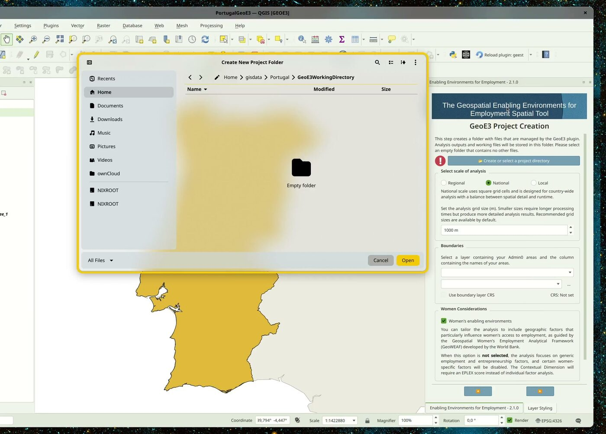

---

## The Study Area Grid

Confirming the wizard computes a regular grid across your study area
(hexagons for Regional, square cells for National/Local) and writes it
into a GeoPackage, along with the masks used throughout the analysis.

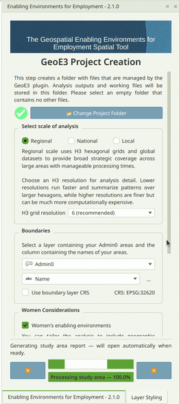

*Live demo — this is animated in the actual plugin.*

A **Study Area Report** opens automatically once it's done — cell
count, processing time per region, and where the files live on disk.

---

## Reading the Dock: a Tree of Dimensions, Factors, Indicators

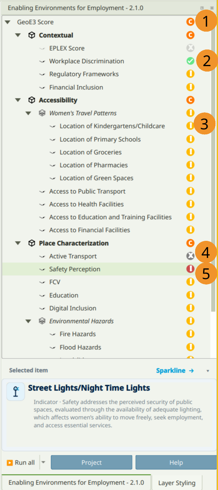

Three **dimensions** (Contextual, Accessibility, Place Characterization)
→ **factors** → **indicators**. Every row carries a status icon:
configured, completed, not configured, disabled, or error.

---

## The Right-Click Menu You'll Use All Day

Every item — indicator, factor, dimension, or the analysis itself —
shares the same context menu:

| Action | What it does |
|---|---|
| **Run Item Workflow** | Computes that item's output |
| **Clear Item** | Resets it so you can reconfigure and rerun |
| **Add to Map** | Adds its output layer group to the Layer Panel |
| **Open Log File** | For when something needs debugging |

**Tip:** to fix a bad input, **Clear Item**, then **Shift + Run Item
Workflow**.

---

<!-- _class: recap -->

## ✅ Checkpoint 1

- [ ] GeoE3 panel is open and docked
- [ ] A new project is created, pointed at your boundary layer
- [ ] The study area grid finished building
- [ ] You can find the status icon on any row in the tree

**Stuck?** Full detail: *The Interface* in the published training docs.

---

<!-- _class: divider -->

### Segment 2 · 10 min

# The Model & Processor Types

How a score gets built, and the techniques behind it

---

## Four Levels, One Pattern

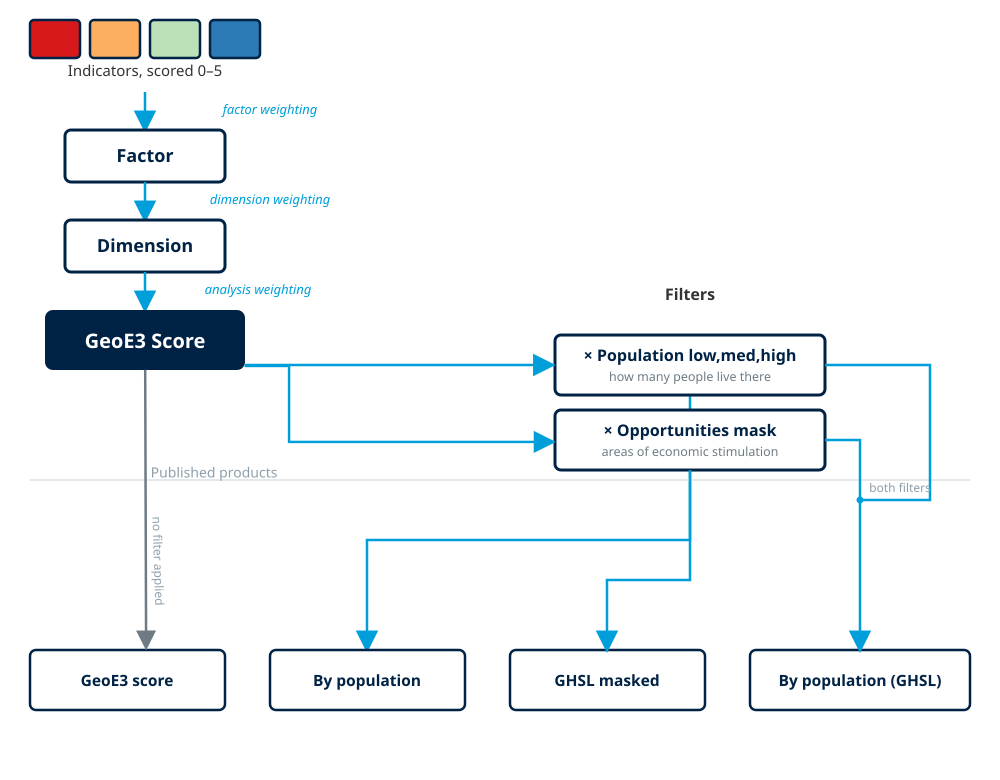

**Indicator → Factor → Dimension → Analysis.** At every level you
assign weights to the children, and the tool combines them into the
parent's score. Weights must sum to **1** — use **Balance Weights** to
split evenly rather than typing each value by hand.

---

## Everything Lands on the Same 0–5 Scale

| Score | Class | Colour |
|---|---|---|
| 0 – 1 | Very Low Enablement | 🟥 |
| 1 – 2 | Low Enablement | 🟧 |
| 2 – 3 | Moderately Enabling | 🟨 |
| 3 – 4 | Enabling | 🟩 |
| 4 – 5 | Highly Enabling | 🟦 |

Rescaling every indicator onto the same 0–5 range — whether the source
was a percentage, a distance, a travel time, or a published index — is
what makes it valid to combine completely different data into one
number.

---

## Processor Types — the Techniques Behind Each Score

| Technique | Used for |
|---|---|
| **National Index Score** | Legal/policy indicators — one value, every cell |
| **Feature Count** | Tallying OSM points inside a cell |
| **Distance Buffer** | Fixed-radius circle around a facility |
| **Network Isochrone** | Travel-time catchment along the road network |

---

## Processor Types — continued

| Technique | Used for |
|---|---|
| **Raster Lookup** | Reading a value straight off an existing map |
| **Zone Classification** | Looking up a boundary polygon's attribute |
| **Population Share** | A pre-matched demographic figure |
| **Weighted Feature Average** | Every intersecting feature, weighted |

You don't need to memorise these — each indicator's configuration
dialog already uses the right one. Full detail: *Processor Types*.

---

<!-- _class: divider -->

### Segment 3 · 10 min

# Getting Data

Automatic downloads, open datasets, and manual entry

---

## Three Ways GeoE3 Gets Data

1. **Fully automatic** — many indicators have a **Download from OSM**
   or **Download from S2S** button right in their dialog. Regional
   projects can even prefetch every Space2Stats indicator in one go
   during project setup.
2. **Open datasets you fetch yourself** — Geofabrik (OSM extracts),
   GADM (admin boundaries), HDX (humanitarian data), WorldPop
   (population by age/sex).
3. **Manual research** — a handful of Contextual indicators (EPLEX,
   WBL) are entered as a single researched national score.

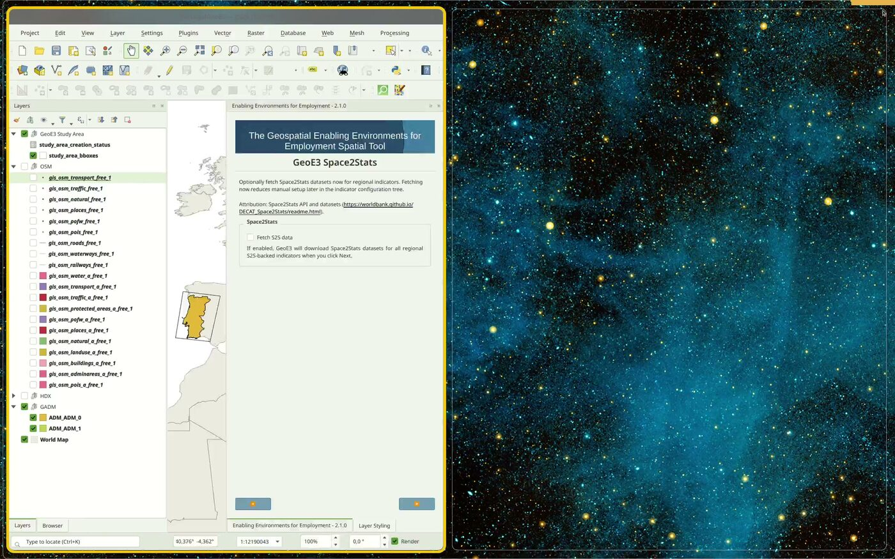

---

## Quick Reference: Where to Get What

| Need | Source |
|---|---|
| Roads, points of interest | Geofabrik / OSM download button |
| Admin boundaries | GADM |
| Humanitarian/crisis data | HDX |
| Population by age & sex | WorldPop |
| Legal/policy scores | Manual entry (WBL, EPLEX) |

Full step-by-step for each source: *Getting Data* in the training docs.

---

<!-- _class: recap -->

## ✅ Checkpoint 2

- [ ] You know which indicators auto-fetch vs need manual download
- [ ] If working Regional scale: Space2Stats prefetch is ticked
- [ ] You have (or know where to get) a road network for routing

---

<!-- _class: divider -->

### Segment 4 · 10 min

# Configuring Items

One pattern, every level of the tree

---

<!-- _class: steps -->

## The Generic Pattern

1. **Double-click** the item to open its configuration dialog
2. **Point it at data** (indicators) — a loaded layer, a browsed file,
   or **Download from OSM**
3. **Assign Weights** (factors/dimensions/analysis) — must sum to 1
4. **Exclude Unused Items** — untick **Use** rather than leaving it
   half-configured
5. **Balance Weights** — equal share across everything still enabled
6. Click **OK**
7. **Right-click → Run Item Workflow** — green check = success

---

## Don't Have Data for Something?

Not every factor will have a source available — FCV (conflict data)
is the classic example. Rather than leaving it misconfigured:

> - 1. Open the **parent** item (the dimension)
> - 2. Untick **Use** next to the factor you're excluding
> - 3. Press **Balance Weights**

The excluded factor shows a greyed-out icon. It's deliberately out of
the analysis, not broken.

---

## Configuring the Analysis Item Itself

The top-level **GeoE3 Score** uses the same dialog, plus:

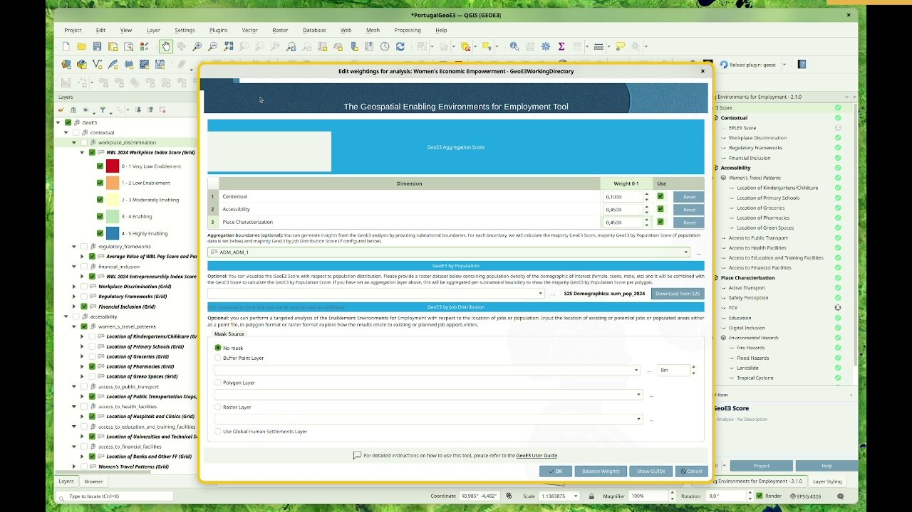

**Aggregation boundary** (subnational breakdown) · **Demographics
layer** (unlocks GeoE3 by Population) · **Mask** (e.g. GHSL
settlements) · **Job distribution** (optional)

---

<!-- _class: recap -->

## ✅ Checkpoint 3

- [ ] You can open any item's dialog and assign weights
- [ ] You know how to exclude an item you don't have data for
- [ ] You've opened the GeoE3 Score item and seen the extra options

---

<!-- _class: divider -->

### Segment 5 · 10 min

# Contextual Dimension

The laws and policies setting the national baseline

---

## What It Measures

The Contextual Dimension covers the laws and policies that shape
workplace gender discrimination, financial autonomy, and overall gender
empowerment — consistent within a country, since national policy
applies uniformly everywhere.

**Every factor uses the National Index Score technique**: one
researched number, typed in once, filled across every cell. No spatial
dataset involved.

Four factors: **Workplace Discrimination · Regulatory Frameworks ·
Financial Inclusion · EPLEX Score / WBL indicators**

---

<!-- _class: steps -->

## Hands-On: Configure a Contextual Factor

1. Expand **Contextual** in the tree
2. **Double-click** a factor (e.g. Workplace Discrimination)
3. Enter the researched national score (see *Getting Data → Manual
   national index-score entry* for sourcing it)
4. Click **OK**
5. **Right-click → Run Item Workflow**
6. Repeat for each remaining factor, then double-click **Contextual**
   itself to set the four factor weights

---

<!-- _class: divider -->

### Segment 6 · 10 min

# Accessibility Dimension

Service areas: childcare, transport, health, education, finance

---

## What It Measures

Accessibility evaluates how easily people reach essential services,
using OpenStreetMap data and network-isochrone analysis:

- **Women's Travel Patterns** — childcare, schools, groceries,
  pharmacies, green space
- **Access to Public Transport**, **Health Facilities**, **Education
  and Training Facilities**, **Financial Facilities**

**Travel mode**: walking (default, distance in metres) or driving
(time in minutes) — use the same mode across all five factors.

---

<!-- _class: steps -->

## Hands-On: Configure an Accessibility Factor

1. **Double-click** a factor, e.g. **Access to Health Facilities**
2. Point it at a facility layer — loaded, browsed, or **Download from
   OSM**
3. Confirm the **travel mode** and distance/time **thresholds**
4. Click **OK**, then **right-click → Run Item Workflow**
5. The output is a set of travel-time zones scored 5 (closest) down to
   0 (out of reach)

Repeat for the other four factors, matching travel mode across all of
them for comparable results.

---

<!-- _class: divider -->

### Segment 7 · 10 min

# Place Characterization Dimension

Safety, walkability, and hazard exposure at the place level

---

## What It Measures

| Factor | What it captures |
|---|---|
| **Active Transport** | Road-network support for walking/cycling |
| **Safety Perception** | Survey data, or night-lights as a proxy |
| **FCV** | ACLED conflict-event overlap and buffers |
| **Education** | % higher-education attainment, settled areas only |
| **Digital Inclusion** | National index + Ookla coverage layers |
| **Environmental Hazards** | Fire, flood, landslide, cyclone, drought |
| **Water Sanitation** | Access to clean water & sanitation |

---

<!-- _class: steps -->

## Hands-On: Configure a Place Characterization Factor

1. **Double-click** a factor, e.g. **Environmental Hazards**
2. Point each of its five sub-indicators (fire, flood, landslide,
   cyclone, drought) at the matching dataset
3. Exclude any you don't have data for, then **Balance Weights**
4. Click **OK**, then **right-click → Run Item Workflow**
5. Repeat for the remaining six factors

Active Transport, Safety and Water Sanitation can be scaled national or
local — match the scale you chose when creating the project.

---

<!-- _class: divider -->

### Segment 8 · 10 min

# Running the Analysis

Kick off the full run, then take a breather

---

## Run All vs Run Incomplete

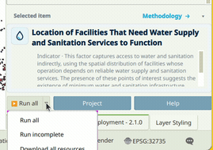

*Live demo — this is animated in the actual plugin.*

**Run All** — runs everything, warns that previous outputs will be
replaced (your working files are safe, only analysis outputs clear).

**Run Incomplete** — skips anything already finished. Use this after a
crash or restart: progress saves to disk after every item, so you never
lose completed work.

---

## ☕ While It Runs

A full run can take a while, especially at national/local resolution
with network-isochrone factors. **Leave it running in the background.**

> **Take 10 minutes.** Stretch, refill your coffee, ask questions.
> We'll reconvene to look at the results together.

---

<!-- _class: divider -->

### Segment 9 · 10 min

# Viewing Your Results

The GeoE3 Score, the bivariate legend, and the study area grid

---

## The Output Group

Results land in the Layer Panel as a group with **Mutually Exclusive
Group** turned on — switching one output's visibility on automatically
turns the others off, so comparisons stay clean.

If results don't appear automatically: right-click **GeoE3 Score** →
**Add to map**.

---

## The Bivariate Legend

Adding a population layer unlocks **GeoE3 by Population**: 5 enablement
levels × 3 population tiers = **15 classes**.

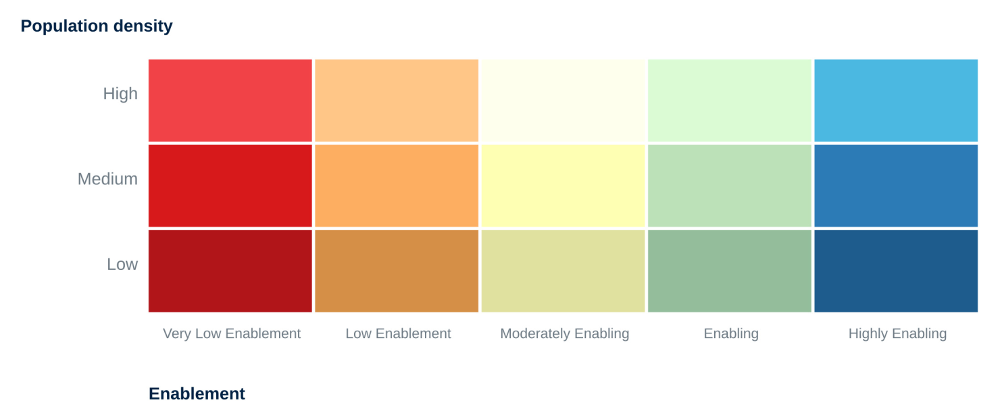

Dark red = low enablement **and** low population. Bright blue = high
enablement **and** high population — read enablement across, density
down.

---

## Finding the Study Area Grid

The underlying grid (and every raw output) lives inside the
`study_area.gpkg` GeoPackage, under the **GeoE3 Study Area** group —
browse to it from the **Browser** panel, not the Layers legend.

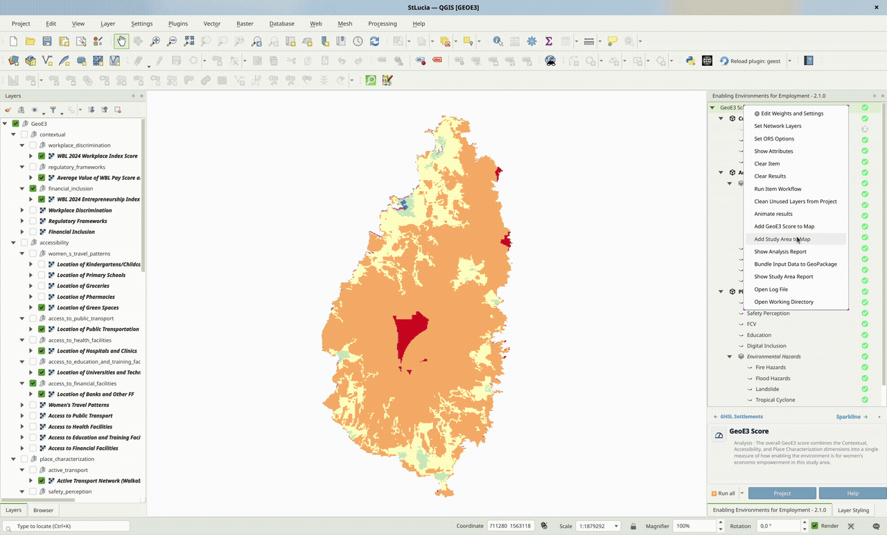

*Live demo — this is animated in the actual plugin.*

---

<!-- _class: recap -->

## ✅ Checkpoint 4

- [ ] Your GeoE3 Score layer is on the map
- [ ] You can explain the bivariate legend to someone else
- [ ] You've located `study_area_grid` in the Browser panel

---

<!-- _class: divider -->

### Segment 10 · 5 min

# The Analysis Report

A full PDF, generated after every run

---

## What's Inside

Right-click the analysis node → **Show Analysis Report** (takes a few
minutes to build).

1. **Credits** — funders and data attribution
2. **Reading the Maps** — the 0–5 and bivariate legends explained
3. **Analysis Overview** — every output, cell-class proportions
4. **Every Dimension and Factor** — one page each
5. **Factor Score Patterns, Low Scores, Settlement/Hazard Patterns**
6. **Factor Correlations** — a heatmap of which factors move together
7. **Methodology, Scoring Weights, Processing Times**

---

## Reading the Correlation Heatmap

- **Deep navy** — the two factors tend to score high in the same
  places (shared root cause — one intervention may move both)
- **Deep red** — one tends to score high where the other scores low
- **Pale/white** — no real relationship
- The diagonal is always navy (a factor always correlates with
  itself) — not a finding

**Tip:** turn on **Subnational score matrix** (Settings → Options →
GeoE3) for a region-by-factor colour grid, off by default.

---

<!-- _class: divider -->

### Segment 11 · 5 min

# Sharing Your Results

Getting the grid out of QGIS, and packaging it for a colleague

---

## Export & Share

- **Add GeoE3 Score to Map** (vector) → open its attribute table →
  export to **CSV** for a spreadsheet, BI tool, or AI workflow
- **Add GeoE3 Aggregates to Map** → subnational breakdown, read with
  the **Identify** tool
- **Open Working Directory** → every file this run produced
- **Bundle Input Data to GeoPackage** → package the whole project into
  one file a colleague can rebuild via **Import a Country Pack**

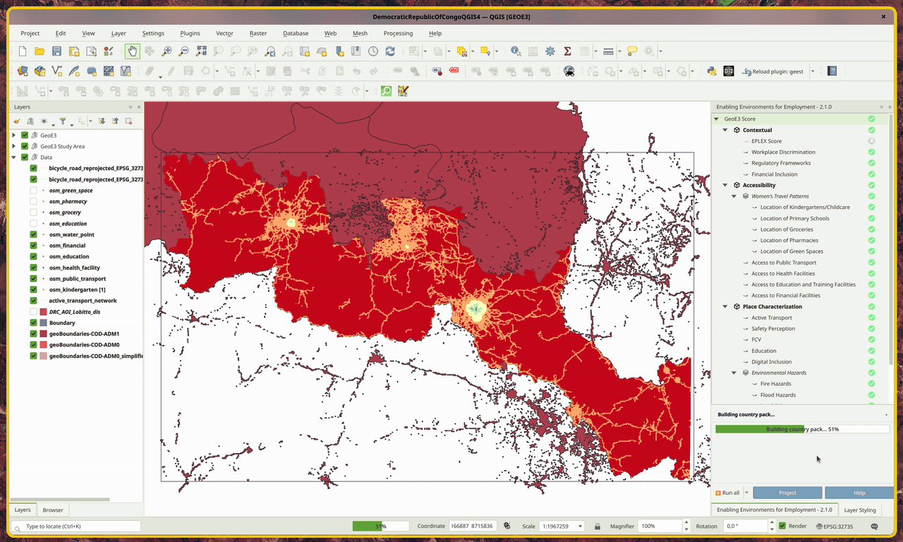

*Live demo — this is animated in the actual plugin.*

---

<!-- _class: divider -->

# Wrap-Up

---

## The Full Pipeline, One Slide

**Install** → **Create project** (study area grid) → **Configure**
every indicator/factor/dimension → **Run All** → **Interpret** (score
map, bivariate legend, PDF report) → **Share** (CSV, country pack)

Same pattern from here on, regardless of country or scale: the three
dimensions, the one configuration pattern, the one 0–5 scale.

---

## Where to Go Next

- **Legacy Detailed Reference** — individual factors in more granular
  detail
- **About** — background on the GeoWEAF framework this tool implements
- **World Bank Group Institute** — periodic scheduled course,
  *Geographic Considerations in Evaluating Women's Employment
  Opportunities*, with a certificate of completion
- Full walkthrough, always up to date:
  **worldbank.github.io/GeoE3**

---

<!-- _class: lead -->

# Questions?

Today's materials, the written walkthrough, and this deck all live in
the GeoE3 repository.

**worldbank.github.io/GeoE3**

---

<!-- _class: lead -->

# Thank You

Made with 💗 by [Kartoza](https://kartoza.com)
[Donate](https://github.com/sponsors/kartoza) · [GitHub](https://github.com/worldbank/GeoE3)

