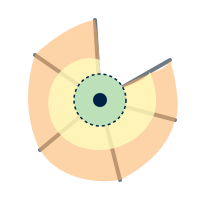
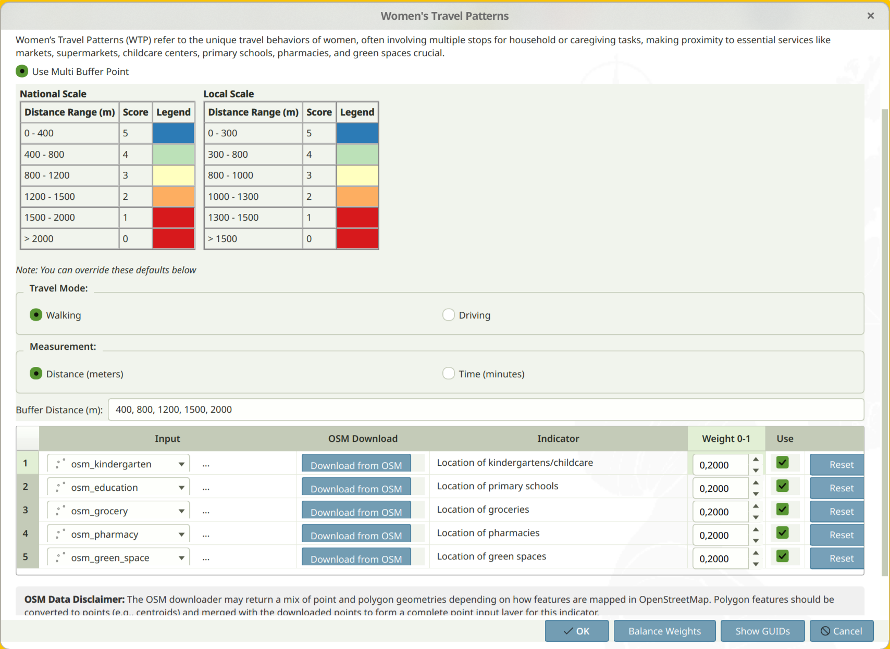
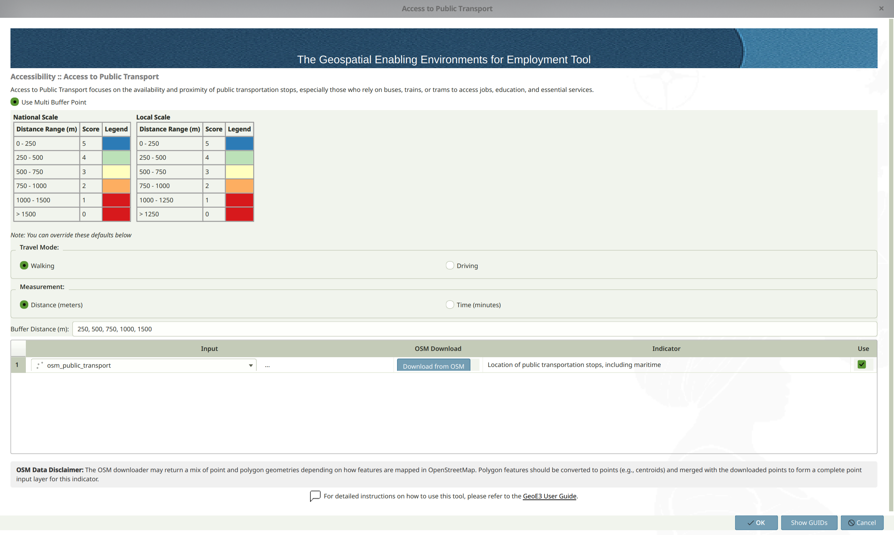
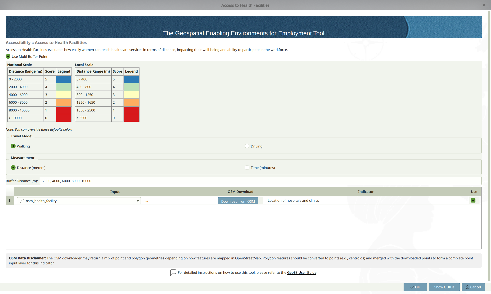
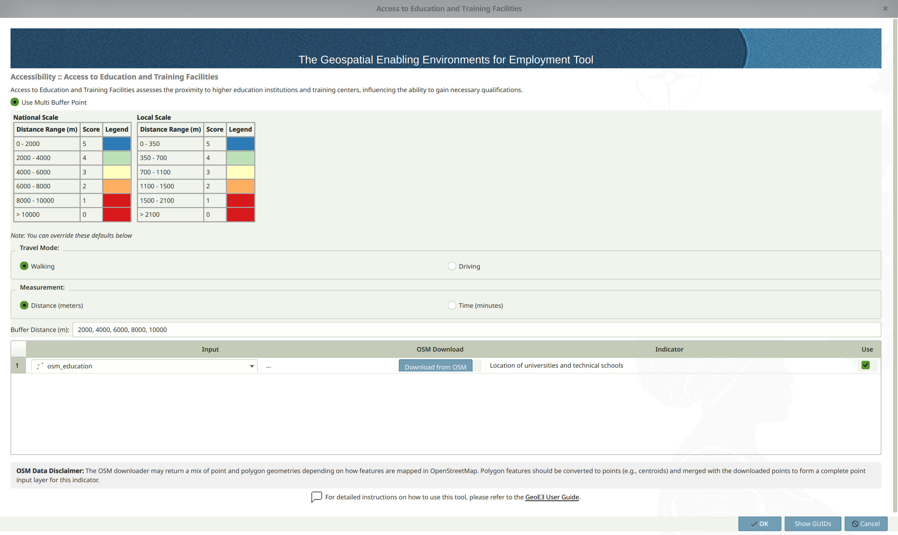
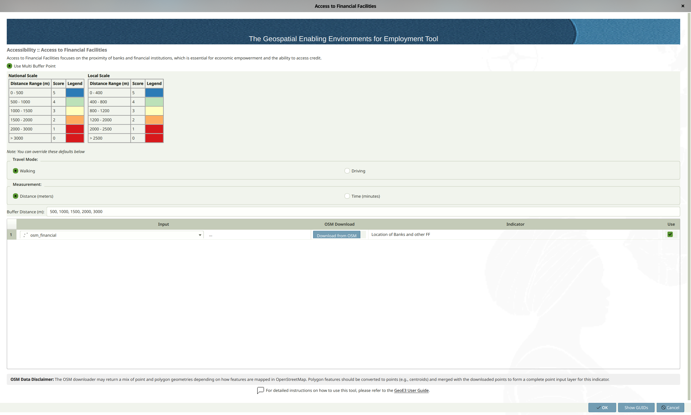
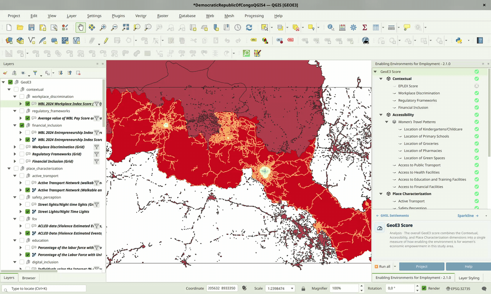

## { width="28" style="vertical-align:middle;margin-right:0.4rem;" } Accessibility

!!! abstract "Learning objective"
    By the end of this page you'll be able to configure all five
    Accessibility factors with point data for the facilities they
    measure, choose an appropriate travel mode and distance thresholds,
    and understand how service-area buffers turn proximity into a 0–5
    score.

The Accessibility Dimension evaluates people's daily mobility by
examining their access to essential services. Levels of enablement for
work access in this dimension are determined by service areas, which
represent the geographic zones that facilities like childcare,
supermarkets, universities, banks, and clinics can serve based on
proximity. The nearer these facilities are to where people live, the
more supportive and enabling the environment becomes for their
participation in the workforce. For more information on data input used
from open sources, see [Getting Data](datacollection.md).

{ style="float:right;width:96px;margin:0 0 0.75rem 1rem;" }

Every Accessibility factor uses the **Distance by Road** technique (see
[Processor Types](processor-types.md#distance-by-road)).
Configure each one using the [generic
pattern](configuring-items.md#the-generic-pattern): double-click, point
it at the relevant point data, and right-click → **Run Item Workflow**
once you're done.

### General Overview
---
This tool evaluates how easily people can access essential services and amenities, considering their potential caregiving roles and daily travel needs. It uses geospatial area analysis with OpenStreetMap (OSM) data to measure accessibility for several factors, including:

- { width="18" style="vertical-align:middle;margin-right:0.3rem;" } **Women’s Travel Patterns:** Access to everyday services like pharmacies, markets, supermarkets, childcare centers, schools and parks.
- { width="18" style="vertical-align:middle;margin-right:0.3rem;" } **Access to Public Transport:** Proximity to bus stops, train stations and other transport facilities.
- { width="18" style="vertical-align:middle;margin-right:0.3rem;" } **Health Facilities:** Availability of clinics, hospitals and other healthcare services.
- { width="18" style="vertical-align:middle;margin-right:0.3rem;" } **Education and Training Facilities:** Distance to colleges, universities and other training centers.
- { width="18" style="vertical-align:middle;margin-right:0.3rem;" } **Financial Facilities:** Access to banks and financial support institutions.

**Travel mode**: The user can select walking or driving as a travel mode, and it is recommended that the same travel mode should be selected for all accessibility factors. The default travel mode is walking due to its inclusive nature.

**Measurement**: The default measurement for travel is distance in meters, which is most appropriate for walking. These thresholds are based on evidence from the literature at the factor level and are designed to provide consistency across analyses. If driving is selected as a travel mode, time in minutes is a more appropriate measurement.

**Thresholds**: They can be adjusted depending on the scope of the analysis. This might be a broader scale, such as the **national level**, or a more localized context, such as **urban or regional** areas.

---

💡 **Tip**: If evidence from the local context suggests alternative thresholds and increments are more appropriate, the user can alter these increments. If the selected travel mode is driving, the equivalent measurement increments should be in minutes and informed by the local context (for example, if evidence suggests the maximum time that women spend driving is 30 minutes, the increments could be 6, 12, 18, 24, 30).

---

**Output**: The process generates zones around these amenities, showing how far people can travel on foot or by car within increasing distances or times. Each zone is assigned a score from 5 (high accessibility) to 0 (no accessibility), reflecting decreasing accessibility as distance or travel time increases.

### Input Accessibility factors
---
#### { width="22" style="vertical-align:middle;margin-right:0.4rem;" } Women’s Travel Patterns (WTP)

**Women's Travel Patterns (WTP)** refer to the unique travel behaviors
of women, often involving multiple stops for household or caregiving
tasks, making proximity to essential services like markets,
supermarkets, childcare centers, primary schools, pharmacies and green
spaces crucial. This factor is composed of 5 subfactors which provide
additional granularity: kindergartens/childcare, primary schools,
groceries, pharmacies and green spaces.

Configure it using the [generic
pattern](configuring-items.md#the-generic-pattern): double-click, point
each subfactor at its point data (or **Download from OSM**), adjust the
travel mode and thresholds if needed, then run it.

<figure markdown>
{ width="75%" }
<figcaption>Women's Travel Patterns input configuration.</figcaption>
</figure>

**Default** Women's Travel Patterns thresholds:

<table>
  <tr>
    <th><strong>Distance to Facilities (meters)</strong> (National Level Analysis)</th>
    <th style="text-align:center;">Score</th>
    <th><strong>Distance to Facilities (meters)</strong> (Local Level Analysis)</th>
    <th style="text-align:center;">Score</th>
  </tr>
  <tr>
    <td>0 - 400</td>
    <td style="text-align:center;">5</td>
    <td>0 - 300</td>
    <td style="text-align:center;">5</td>
  </tr>
  <tr>
    <td>401 - 800</td>
    <td style="text-align:center;">4</td>
    <td>301 - 800</td>
    <td style="text-align:center;">4</td>
  </tr>
  <tr>
    <td>801 - 1,200</td>
    <td style="text-align:center;">3</td>
    <td>801 - 1,000</td>
    <td style="text-align:center;">3</td>
  </tr>
  <tr>
    <td>1,201 - 1,500</td>
    <td style="text-align:center;">2</td>
    <td>1,001 - 1,300</td>
    <td style="text-align:center;">2</td>
  </tr>
  <tr>
    <td>1,501 - 2,000</td>
    <td style="text-align:center;">1</td>
    <td>1,301 - 1,500</td>
    <td style="text-align:center;">1</td>
  </tr>
  <tr>
    <td>Over 2,000</td>
    <td style="text-align:center;">0</td>
    <td>Over 1,500</td>
    <td style="text-align:center;">0</td>
  </tr>
</table>

 

---
#### { width="22" style="vertical-align:middle;margin-right:0.4rem;" } Access to Public Transport

**Access to Public Transport** focuses on the availability and
proximity of public transportation stops, which is crucial for people
that rely on buses, trains, or trams to access jobs, education, and
essential services.

Configure it using the [generic
pattern](configuring-items.md#the-generic-pattern): double-click, point
it at your public transportation stops layer (including maritime stops),
adjust the travel mode and thresholds if needed, then run it.

<figure markdown>
{ width="75%" }
<figcaption>Access to Public Transport input configuration.</figcaption>
</figure>

**Default** Access to Public Transport thresholds:

<table>
  <tr>
    <th><strong>Distance to Public Transport Stops (meters)</strong> (National Level Analysis)</th>
    <th style="text-align:center;">Score</th>
    <th><strong>Distance to Public Transport Stops (meters)</strong> (Local Level Analysis)</th>
    <th style="text-align:center;">Score</th>
  </tr>
  <tr>
    <td>0 - 250</td>
    <td style="text-align:center;">5</td>
    <td>0 - 250</td>
    <td style="text-align:center;">5</td>
  </tr>
  <tr>
    <td>251 - 500</td>
    <td style="text-align:center;">4</td>
    <td>251 - 500</td>
    <td style="text-align:center;">4</td>
  </tr>
  <tr>
    <td>501 - 750</td>
    <td style="text-align:center;">3</td>
    <td>501 - 750</td>
    <td style="text-align:center;">3</td>
  </tr>
  <tr>
    <td>751 - 1,000</td>
    <td style="text-align:center;">2</td>
    <td>751 - 1,000</td>
    <td style="text-align:center;">2</td>
  </tr>
  <tr>
    <td>1,001 - 1,500</td>
    <td style="text-align:center;">1</td>
    <td>1,001 - 1,250</td>
    <td style="text-align:center;">1</td>
  </tr>
  <tr>
    <td>Over 1,500</td>
    <td style="text-align:center;">0</td>
    <td>Over 1,250</td>
    <td style="text-align:center;">0</td>
  </tr>
</table>

 

---
#### { width="22" style="vertical-align:middle;margin-right:0.4rem;" } Access to Health Facilities

**Access to Health Facilities** evaluates how easily people can reach
healthcare services in terms of distance, impacting their well-being
and ability to participate in the workforce.

Configure it using the [generic
pattern](configuring-items.md#the-generic-pattern): double-click, point
it at your hospitals and clinics layer, adjust the travel mode and
thresholds if needed, then run it.

<figure markdown>
{ width="75%" }
<figcaption>Access to Health Facilities input configuration.</figcaption>
</figure>

**Default** Access to Health Facilities thresholds:

<table>
  <tr>
    <th><strong>Distance to Health Facilities (meters)</strong> (National Level Analysis)</th>
    <th style="text-align:center;">Score</th>
    <th><strong>Distance to Health Facilities (meters)</strong> (Local Level Analysis)</th>
    <th style="text-align:center;">Score</th>
  </tr>
  <tr>
    <td>0 - 2,000</td>
    <td style="text-align:center;">5</td>
    <td>0 - 400</td>
    <td style="text-align:center;">5</td>
  </tr>
  <tr>
    <td>2,001 - 4,000</td>
    <td style="text-align:center;">4</td>
    <td>401 - 800</td>
    <td style="text-align:center;">4</td>
  </tr>
  <tr>
    <td>4,001 - 6,000</td>
    <td style="text-align:center;">3</td>
    <td>801 - 1,250</td>
    <td style="text-align:center;">3</td>
  </tr>
  <tr>
    <td>6,001 - 8,000</td>
    <td style="text-align:center;">2</td>
    <td>1,251 - 1,650</td>
    <td style="text-align:center;">2</td>
  </tr>
  <tr>
    <td>8,001 - 10,000</td>
    <td style="text-align:center;">1</td>
    <td>1,651 - 2,500</td>
    <td style="text-align:center;">1</td>
  </tr>
  <tr>
    <td>Over 10,000</td>
    <td style="text-align:center;">0</td>
    <td>Over 2,500</td>
    <td style="text-align:center;">0</td>
  </tr>
</table>

 

---
#### { width="22" style="vertical-align:middle;margin-right:0.4rem;" } Access to Education and Training Facilities

**Access to Education and Training Facilities** assesses the proximity
to higher education institutions and training centers, influencing
people's ability to gain necessary qualifications.

Configure it using the [generic
pattern](configuring-items.md#the-generic-pattern): double-click, point
it at your universities and technical schools layer, adjust the travel
mode and thresholds if needed, then run it.

<figure markdown>
{ width="75%" }
<figcaption>Access to Education and Training Facilities input configuration.</figcaption>
</figure>

**Default** Access to Education and Training Facilities thresholds:

<table>
  <tr>
    <th><strong>Distance to Facilities (meters)</strong> (National Level Analysis)</th>
    <th style="text-align:center;">Score</th>
    <th><strong>Distance to Facilities (meters)</strong> (Local Level Analysis)</th>
    <th style="text-align:center;">Score</th>
  </tr>
  <tr>
    <td>0 - 2,000</td>
    <td style="text-align:center;">5</td>
    <td>0 - 350</td>
    <td style="text-align:center;">5</td>
  </tr>
  <tr>
    <td>2,001 - 4,000</td>
    <td style="text-align:center;">4</td>
    <td>351 - 700</td>
    <td style="text-align:center;">4</td>
  </tr>
  <tr>
    <td>4,001 - 6,000</td>
    <td style="text-align:center;">3</td>
    <td>701 - 1,100</td>
    <td style="text-align:center;">3</td>
  </tr>
  <tr>
    <td>6,001 - 8,000</td>
    <td style="text-align:center;">2</td>
    <td>1,101 - 1,500</td>
    <td style="text-align:center;">2</td>
  </tr>
  <tr>
    <td>8,001 - 10,000</td>
    <td style="text-align:center;">1</td>
    <td>1,501 - 2,100</td>
    <td style="text-align:center;">1</td>
  </tr>
  <tr>
    <td>Over 10,000</td>
    <td style="text-align:center;">0</td>
    <td>Over 2,100</td>
    <td style="text-align:center;">0</td>
  </tr>
</table>

 

---
#### { width="22" style="vertical-align:middle;margin-right:0.4rem;" } Access to Financial Facilities

**Access to Financial Facilities** focuses on the proximity of banks
and financial institutions, which is essential for people's economic
empowerment and ability to access credit.

Configure it using the [generic
pattern](configuring-items.md#the-generic-pattern): double-click, point
it at your banks and financial facilities layer, adjust the travel mode
and thresholds if needed, then run it.

<figure markdown>
{ width="75%" }
<figcaption>Access to Financial Facilities input configuration.</figcaption>
</figure>

**Default** Access to Financial Facilities thresholds:

<table>
  <tr>
    <th><strong>Distance to Financial Facilities (meters)</strong> (National Level Analysis)</th>
    <th style="text-align:center;">Score</th>
    <th><strong>Distance to Financial Facilities (meters)</strong> (Local Level Analysis)</th>
    <th style="text-align:center;">Score</th>
  </tr>
  <tr>
    <td>0 - 400</td>
    <td style="text-align:center;">5</td>
    <td>0 - 500</td>
    <td style="text-align:center;">5</td>
  </tr>
  <tr>
    <td>401 - 800</td>
    <td style="text-align:center;">4</td>
    <td>501 - 1,000</td>
    <td style="text-align:center;">4</td>
  </tr>
  <tr>
    <td>801 - 1,200</td>
    <td style="text-align:center;">3</td>
    <td>1,001 - 1,500</td>
    <td style="text-align:center;">3</td>
  </tr>
  <tr>
    <td>1,201 - 2,000</td>
    <td style="text-align:center;">2</td>
    <td>1,501 - 2,000</td>
    <td style="text-align:center;">2</td>
  </tr>
  <tr>
    <td>2,001 - 3,000</td>
    <td style="text-align:center;">1</td>
    <td>2,001 - 2,500</td>
    <td style="text-align:center;">1</td>
  </tr>
  <tr>
    <td>Over 3,000</td>
    <td style="text-align:center;">0</td>
    <td>Over 2,500</td>
    <td style="text-align:center;">0</td>
  </tr>
</table>

 

---

Once every factor has its data, double-click the **Accessibility**
dimension and follow the same [generic
pattern](configuring-items.md#the-generic-pattern) as every other item
in the tree: assign weights, balance them, and run it.

<figure markdown>
{ width="75%" }
<figcaption>Assigning weights across the five Accessibility factors.</figcaption>
</figure>

The outputs (all five factors and their subfactors, plus their
aggregation into the final Accessibility score) land in the
Accessibility folder within your project folder, on the usual
[0–5 enablement scale](the-model.md#the-05-likert-scale).

!!! success "Recap"
    - All five Accessibility factors need point data for the facility
      they measure. Grab it with the in-app **Download from OSM**
      button, or see [Getting Data](datacollection.md) for alternatives.
    - Pick one travel mode (walking or driving) and stick with it across
      every factor for consistent, comparable results.
    - Distance thresholds differ by factor and by national vs. local
      scale. The defaults are evidence-based, but override them if your
      local context calls for it.
    - Results combine into a single Accessibility output on the usual
      0–5 enablement scale.
