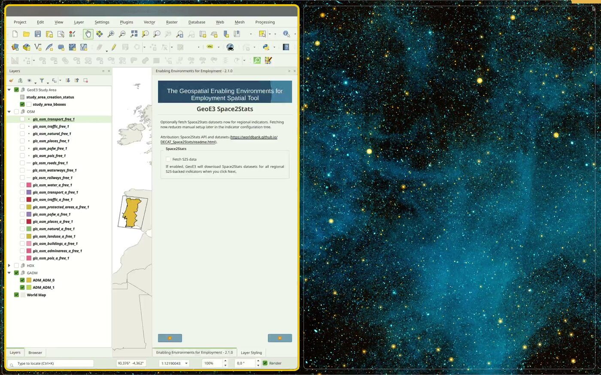
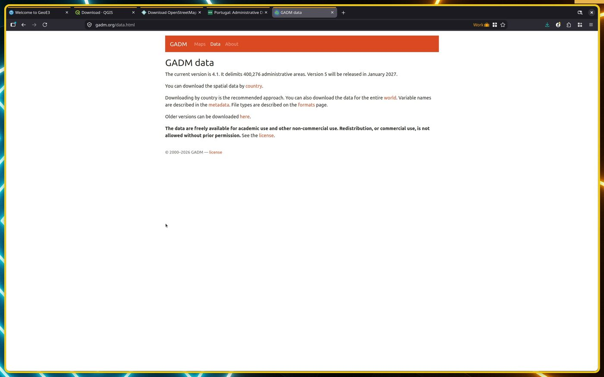
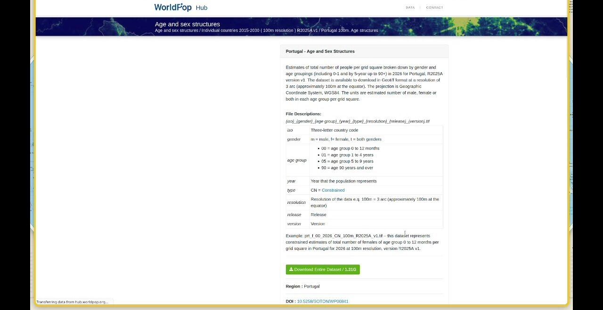

# Getting Data

!!! abstract "Learning objective"
    By the end of this page you'll know every way GeoE3 gets its input
    data — what downloads automatically, what you fetch yourself and
    import, and what you research and type in by hand — so you can source
    data confidently for any country, not just the Portugal example used
    throughout this walkthrough.

Every indicator in the GeoE3 model needs a dataset or a number behind it.
There are three distinct ways that data gets into your project:

1. **Automatic, in-app downloads** — GeoE3 fetches it for you, no browser
   required.
2. **Manual download and import** — you find a dataset on an external
   website, download it, and load it into QGIS yourself.
3. **Manual research and entry** — for national-level indicators (like
   workplace discrimination law), you research a published score and type
   a single number into the plugin.

This page works through each one as a short, self-contained tutorial. Skip
to whichever source you need.

## Pre-built geodatabases for SIDS countries

If the country you're analysing is one of the Small Island Developing
States (SIDS) covered by the World Bank's original GeoWEAF pilot, you may
not need to assemble your own data at all: a ready-made geodatabase
already exists. The [World Bank Gender Spatial data
catalogue](https://datacatalog.worldbank.org/search/collections/genderspatial)
collects the spatial GDBs for every SIDS pilot country, pre-built for use
with this tool.

## Tutorial: automatic downloads built into GeoE3

There's another way to get data besides going and fetching it yourself:
you can also use the built-in downloader tool, which is based on
[QuickOSM](https://docs.3liz.org/QuickOSM/) logic. Click the **Download
from OSM** button inside an indicator's dialog, and it will do a query
from OpenStreetMap and fetch down the specific data that indicator
needs — childcare facilities, for example, if that's the one you're
configuring.

<figure markdown>

<figcaption>The <strong>OSM Download</strong> button inside an indicator dialog — here, Women's Travel Patterns.</figcaption>
</figure>

!!! note
    Quite often the servers are busy and it might fail — I suggest you
    just keep trying every few minutes until it works for you.

One of the nice things about setting up a project is that if you're doing
a **regional**-scale one, you can also prefetch a bunch of data for your
analysis. Tick the box in the setup wizard and click Next, and it's going
to go and download a bunch of indicators — a bunch of reference datasets,
Space2Stats, that we can use for the analysis.

<figure markdown>

<figcaption>Tick "Fetch S2S data" during project setup and GeoE3 downloads everything it needs for every Space2Stats-backed indicator.</figcaption>
</figure>

GHSL (Global Human Settlement Layer) settlement/population classification
and Ookla open broadband/mobile coverage also get fetched automatically
in the background the first time a workflow needs them — there's nothing
to click for those.

This whole process is about collecting data, and there are a bunch of
different sources you can fetch it from: there's the Space2Stats program,
which is World Bank hosted data; there's OpenStreetMap — which basically
you wouldn't get straight from OpenStreetMap, you'd get it from a service
like the Geofabrik service below, or using the QuickOSM downloader tool,
or using the button inside of the indicator, which also basically uses
QuickOSM underneath the hood; or you might get it from your national
dataset, from whatever your country's official data sources provide.

## Tutorial: OpenStreetMap extracts from Geofabrik

For a national or local-scale project — where Space2Stats' regional
prefetch doesn't apply — to get busy with actually using the plugin, we
need to get some data. What I recommend is to head over to
[Geofabrik](https://www.geofabrik.de/) to start off. Geofabrik is an
amazing website where they provide extracts from OpenStreetMap for free,
and you can just go and download any data you want.

<figure markdown>

<figcaption>Geofabrik's download server — free OSM extracts, updated daily, organised by continent then country.</figcaption>
</figure>

Go to the Geofabrik homepage, then **Data**, then **Downloads**. Click the
link at the top and it's split up by regions, so you just start drilling
down to your region — continent, then country (and sometimes there are
sub-regions too, for larger countries). You can download it in different
ways: individual files, or one big file which has got kind of everything
in it — grab the latest free `.gpkg.zip` (GeoPackage) if it's offered.
Once it's downloaded, extract it, add it to QGIS, and right-click the
folder in the **Browser** panel → **Add as a Favorite**, which will make
it easy to work with the data in that folder going forward.

The geopackage is more convenient because you get everything in one
single file — you don't have a lot of files all over your hard drive to
keep track of. But if there's an error in the file, you can go to plan B,
which is to download the shapefiles instead — or use GADM (below) for
boundaries specifically.

## Tutorial: official administrative boundaries from GADM

Sometimes the admin boundary you get from OpenStreetMap or HDX still
isn't quite what you want — it might include the coastal maritime area
rather than the land boundary you need, or the highest level available
might not be the one you're after. If you don't have what you want yet,
the next option is to use [GADM](https://gadm.org/) boundaries.

You could search just for "[your country] official boundary" and see if
you can find it published by an official source — quite difficult to do,
though if you're working in your own country, maybe you're already
familiar with where to get the official data. I happen to know about
GADM:

<figure markdown>

<figcaption>GADM — pick your country, download a GeoPackage of its administrative boundaries at every level.</figcaption>
</figure>

Here you can also download data by country — choose yours, and again, you
can get a geopackage, which is always nicer. It contains one layer per
administrative level (`ADM_0` for the national boundary, `ADM_1` for the
first subdivision, and so on) — finally, what we need.

!!! warning "Check the license before you redistribute anything"
    GADM data is free for **academic and non-commercial use**.
    Redistribution or commercial use needs permission from GADM first —
    see their [license page](https://gadm.org/license.html) before you
    publish an analysis built on it.

## Tutorial: Humanitarian Data Exchange (HDX)

Another common source of data is the [Humanitarian Data
Exchange](https://data.humdata.org/), HDX for short. GeoE3 does **not**
query it automatically — this is a manual browse-and-download source, the
same as Geofabrik or GADM. Punch in your country and you'll see a range
of interesting-looking datasets: health, population, airports, railways,
buildings, education. Some of these will be useful for you — but you want
only the geospatial data, so filter on **geodata** to narrow it down.

<figure markdown>

<figcaption>Filtering an HDX search down to geospatial datasets only.</figcaption>
</figure>

For example, health facilities is going to be one of the things you're
interested in for the Accessibility dimension — since it's there on HDX,
grab it. (The source is still coming from HDX, though it looks like they
get it from HOT OSM.) Open the dataset page, scroll to **Data and
Resources**, and download the shapefile or GeoPackage.

<figure markdown>

<figcaption>Downloading the point-data resource for a dataset.</figcaption>
</figure>

HDX is a good first stop for health facilities and some administrative
boundary sets, but coverage varies a lot by country — if it doesn't have
what you need, fall back to the in-app OSM downloader or Geofabrik.

## Tutorial: population data from WorldPop

If you want to introduce population into your results (see [Configuring
Items](configuring-items.md)) and you already ticked **Fetch S2S data**
during project setup, you likely already have a Space2Stats population
layer and can skip this. If not, getting it is its own little side quest.

There are various places to get population data. You can go to the
Humanitarian Data Exchange — ideally looking for the group you're trying
to foster enablement for (women's census population, say), though it's
not always there as a clean geospatial layer. Failing that, go to
[WorldPop](https://hub.worldpop.org/). WorldPop is an open data
initiative for providing population data for around the world.

Under national boundaries you can download the total population for a
given year. But if you want more, you can also get the demographic
breakdown — go to **Age and sex structures** and you can get individual
countries from there.

<figure markdown>

<figcaption>WorldPop's per-country age/sex breakdowns — useful if you want to target a specific demographic, not just total population.</figcaption>
</figure>

The filename encodes exactly what's inside it — country code, gender, age
band, year and resolution — so you can tell at a glance which file has,
for example, working-age women.

## Tutorial: manual national index-score entry

This class of indicators — the four Contextual-dimension factors, EPLEX
Score, Workplace Discrimination, Regulatory Frameworks and Financial
Inclusion — is calculated using a national score. It assigns one number
to the whole dataset based on, for example, what the workplace
discrimination environment is like. You need to do your research, find
out for your country what level of enablement there is in the
legislation, and if it's highly enabling, for example, you'd give it a 95
or plus; if it's some order below that, you'd give it a rating as
appropriate.

The table below gives a worked Saint Lucia example and the general
sources to use for any other country. If you'd rather skip the lookup
entirely, the [WBL Index Reference](wbl-reference.md) page lists the
Workplace Discrimination, Regulatory Frameworks and Financial Inclusion
default score for every country in one table.

## Data sources used for the Saint Lucia example

<table>
  <tr>
    <th style="text-align: center;"><b>DIMENSION</b></th>
    <th style="text-align: center;"><b>FACTOR</b></th>
    <th style="text-align: center;"><b>LAYER</b></th>
    <th style="text-align: center;"><b>DATA SOURCE/QUERY</b></th>
  </tr>

  <!-- Contextual Section with Merged DIMENSION Cell -->

  <tr>
    <td rowspan="4" style="text-align: center;">📝CONTEXTUAL</td>
    <td style="text-align: left;">🏢Workplace Discrimination</td>
    <td style="text-align: left;">WBL 2024 Workplace Index Score</td>
<td style="text-align: left;">
    <a href="https://wbl.worldbank.org/en/wbl" target="_blank">
        WBL 2024 index score
    </a>
</td>

  </tr>
  <tr>
    <td style="text-align: left;">⚖️Regulatory Frameworks</td>
    <td style="text-align: left;">WBL 2024 Pay+Parenthood Index Score</td>
    <td style="text-align: left;">
    <a href="https://wbl.worldbank.org/en/wbl" target="_blank">
        WBL 2024 index score for Pay and Parenthood
    </a>
  </tr>
  <tr>
    <td style="text-align: left;">💵Financial Inclusion</td>
    <td style="text-align: left;">WBL 2024 Entrepreneurship Index Score</td>
 <td style="text-align: left;">
    <a href="https://wbl.worldbank.org/en/wbl" target="_blank">
        WBL 2024 index score for Entrepreneurship
    </a>
  </tr>
  <tr>
    <td style="text-align: left;">🏢EPLEX</td>
    <td style="text-align: left;">The Employment Protection Legislation Index</td>
 <td style="text-align: left;">
    <a href="https://eplex.ilo.org/en#indicators-section" target="_blank">
        EPLEX Score
    </a>
  </tr>

  <!-- Accessibility Section with Merged DIMENSION Cell -->
  <tr>
    <td rowspan="9" style="text-align: center;">🚶ACCESSIBILITY</td>
    <td rowspan="5" style="text-align: left;">🚶‍♀️Women's Travel Patterns</td>
    <td style="text-align: left;">👶Location of kindergartens/childcare</td>
 <td style="text-align: left;">
    <a href="https://data.humdata.org/dataset" target="_blank">
        Humdata
    </a>
    or
    <a href="https://overpass-turbo.eu/?Q=[out:xml][timeout:25];{{geocodeArea:Saint%20Lucia}}->.area_0;(node[%22amenity%22=%22kindergarten%22](area.area_0);way[%22amenity%22=%22kindergarten%22](area.area_0);relation[%22amenity%22=%22kindergarten%22](area.area_0););(._;>;);out%20body;" target="_blank">
        OSM
    </a>
</td>
</tr>
  <tr>
    <td style="text-align: left;">🏫Location of primary schools</td>
<td style="text-align: left;">
    <a href="https://data.humdata.org/dataset" target="_blank">
        Humdata
    </a>
   or
    <a href="https://overpass-turbo.eu/?Q=[out:xml][timeout:25];{{geocodeArea:Saint%20Lucia}}->.area_0;(node[%22amenity%22=%22school%22](area.area_0);way[%22amenity%22=%22school%22](area.area_0);relation[%22amenity%22=%22school%22](area.area_0););(._;>;);out%20body;" target="_blank">
        OSM
    </a>
</td>
  </tr>
  <tr>
    <td style="text-align: left;">🛒Location of groceries</td>
<td style="text-align: left;">
    <a href="https://overpass-turbo.eu/?Q=[out:xml][timeout:25];{{geocodeArea:Saint%20Lucia}}->.area_0;(node[%22shop%22=%22greengrocer%22](area.area_0);way[%22shop%22=%22greengrocer%22](area.area_0);relation[%22shop%22=%22greengrocer%22](area.area_0););(._;>;);out%20body;" target="_blank">
        OSM
    </a>
</td>
  </tr>
  <tr>
    <td style="text-align: left;">💊Location of pharmacies</td>
<td style="text-align: left;">
    <a href="https://overpass-turbo.eu/?Q=[out:xml][timeout:25];{{geocodeArea:Saint%20Lucia}}->.area_0;(node[%22amenity%22=%22pharmacy%22](area.area_0);way[%22amenity%22=%22pharmacy%22](area.area_0);relation[%22amenity%22=%22pharmacy%22](area.area_0););(._;>;);out%20body;" target="_blank">
        OSM
    </a>
</td>
  </tr>
  <tr>
    <td style="text-align: left;">🌳Location of green spaces</td>
<td style="text-align: left;">
    <a href="https://overpass-turbo.eu/?Q=[out:xml][timeout:25];{{geocodeArea:Saint%20Lucia}}->.area_0;(node[%22leisure%22=%22park%22](area.area_0);node[%22boundary%22=%22national_park%22](area.area_0);way[%22leisure%22=%22park%22](area.area_0);way[%22boundary%22=%22national_park%22](area.area_0);relation[%22leisure%22=%22park%22](area.area_0);relation[%22boundary%22=%22national_park%22](area.area_0););(._;>;);out%20body;" target="_blank">
        OSM
    </a>
</td>
</tr>
  <tr>
    <td style="text-align: left;">🚌Access to Public Transport</td>
    <td style="text-align: left;">Location of public transportation stops, including maritime</td>
<td style="text-align: left;">
    <a href="https://overpass-turbo.eu/?Q=[out:xml][timeout:25];{{geocodeArea:Saint%20Lucia}}->.area_0;(node[%22public_transport%22=%22stop_position%22](area.area_0);node[%22public_transport%22=%22platform%22](area.area_0);node[%22public_transport%22=%22station%22](area.area_0);node[%22public_transport%22=%22stop_area%22](area.area_0);node[%22highway%22=%22bus_stop%22](area.area_0);node[%22highway%22=%22platform%22](area.area_0);way[%22public_transport%22=%22stop_position%22](area.area_0);way[%22public_transport%22=%22platform%22](area.area_0);way[%22public_transport%22=%22station%22](area.area_0);way[%22public_transport%22=%22stop_area%22](area.area_0);way[%22highway%22=%22bus_stop%22](area.area_0);way[%22highway%22=%22platform%22](area.area_0);relation[%22public_transport%22=%22stop_position%22](area.area_0);relation[%22public_transport%22=%22platform%22](area.area_0);relation[%22public_transport%22=%22station%22](area.area_0);relation[%22public_transport%22=%22stop_area%22](area.area_0);relation[%22highway%22=%22bus_stop%22](area.area_0);relation[%22highway%22=%22platform%22](area.area_0);node[%22amenity%22=%22ferry_terminal%22](area.area_0);way[%22amenity%22=%22ferry_terminal%22](area.area_0);relation[%22amenity%22=%22ferry_terminal%22](area.area_0););(._;>;);out%20body;" target="_blank">
        OSM
    </a>
</td>
</tr>
  <tr>
    <td style="text-align: left;">🏥Access to Health Facilities</td>
    <td style="text-align: left;">Location of hospitals and clinics</td>
<td style="text-align: left;">
    <a href="https://data.humdata.org/dataset" target="_blank">
        Humdata
    </a>
    or
    <a href="https://overpass-turbo.eu/?Q=[out:xml][timeout:25];{{geocodeArea:Saint%20Lucia}}->.area_0;(node[%22amenity%22=%22dentist%22](area.area_0);node[%22amenity%22=%22doctors%22](area.area_0);node[%22amenity%22=%22hospital%22](area.area_0);node[%22amenity%22=%22clinic%22](area.area_0);way[%22amenity%22=%22dentist%22](area.area_0);way[%22amenity%22=%22doctors%22](area.area_0);way[%22amenity%22=%22hospital%22](area.area_0);way[%22amenity%22=%22clinic%22](area.area_0);relation[%22amenity%22=%22dentist%22](area.area_0);relation[%22amenity%22=%22doctors%22](area.area_0);relation[%22amenity%22=%22hospital%22](area.area_0);relation[%22amenity%22=%22clinic%22](area.area_0););(._;>;);out%20body;" target="_blank">
        OSM
    </a>
</td>
</tr>
  <tr>
    <td style="text-align: left;">🎓Access to Education and Training Facilities</td>
    <td style="text-align: left;">Location of universities and technical schools</td>
<td style="text-align: left;">
    <a href="https://data.humdata.org/dataset" target="_blank">
        Humdata
    </a>
    or
    <a href="https://overpass-turbo.eu/?Q=[out:xml][timeout:25];{{geocodeArea:Saint%20Lucia}}->.area_0;(node[%22amenity%22=%22university%22](area.area_0);way[%22amenity%22=%22university%22](area.area_0);relation[%22amenity%22=%22university%22](area.area_0););(._;>;);out%20body;" target="_blank">
        OSM
    </a>
</td>
</tr>
  <tr>
    <td style="text-align: left;">🏦Access to Financial Facilities</td>
    <td style="text-align: left;">Location of Banks and other financial facilities</td>
<td style="text-align: left;">
    <a href="https://overpass-turbo.eu/?Q=[out:xml][timeout:25];{{geocodeArea:Saint%20Lucia}}->.area_0;(node[%22amenity%22=%22bank%22](area.area_0);node[%22office%22=%22financial%22](area.area_0);way[%22amenity%22=%22bank%22](area.area_0);way[%22office%22=%22financial%22](area.area_0);relation[%22amenity%22=%22bank%22](area.area_0);relation[%22office%22=%22financial%22](area.area_0););(._;>;);out%20body;" target="_blank">
        OSM
    </a>
</td>
</tr>

  <!-- Place Characterization Section with Merged DIMENSION Cell -->
  <tr>
    <td rowspan="10" style="text-align: center;">🌍PLACE CHARACTERIZATION</td>
    <td rowspan="4" style="text-align: left;">🚴Active Transport</td>
    <td style="text-align: left;">🚸Location of street crossings</td>
<td style="text-align: left;">
    <a href="https://www.mapillary.com/developer/api-documentation/points" target="_blank">
        Mapillary
    </a>
   or
    <a href="https://overpass-turbo.eu/?Q=[out:xml][timeout:25];{{geocodeArea:Saint%20Lucia}}->.area_0;(node[%22highway%22=%22crossing%22](area.area_0);node[%22railway%22=%22crossing%22](area.area_0);way[%22highway%22=%22crossing%22](area.area_0);way[%22railway%22=%22crossing%22](area.area_0);relation[%22highway%22=%22crossing%22](area.area_0);relation[%22railway%22=%22crossing%22](area.area_0););(._;>;);out%20body;" target="_blank">
        OSM
    </a>
</td>
</tr>
  <tr>
    <td style="text-align: left;">🚴‍♀️Location of cycle paths</td>
<td style="text-align: left;">
    <a href="https://overpass-turbo.eu/?Q=[out:xml][timeout:25];{{geocodeArea:Saint%20Lucia}}->.area_0;(node[%22highway%22=%22cycleway%22](area.area_0);node[%22highway%22=%22track%22](area.area_0);node[%22cycleway%22=%22track%22](area.area_0);node[%22cycleway%22=%22lane%22](area.area_0);node[%22cycleway%22=%22share_busway%22](area.area_0);node[%22cycleway%22=%22shared_lane%22](area.area_0);way[%22highway%22=%22cycleway%22](area.area_0);way[%22highway%22=%22track%22](area.area_0);way[%22cycleway%22=%22track%22](area.area_0);way[%22cycleway%22=%22lane%22](area.area_0);way[%22cycleway%22=%22share_busway%22](area.area_0);way[%22cycleway%22=%22shared_lane%22](area.area_0);relation[%22highway%22=%22cycleway%22](area.area_0);relation[%22highway%22=%22track%22](area.area_0);relation[%22cycleway%22=%22track%22](area.area_0);relation[%22cycleway%22=%22lane%22](area.area_0);relation[%22cycleway%22=%22share_busway%22](area.area_0);relation[%22cycleway%22=%22shared_lane%22](area.area_0););(._;>;);out%20body;" target="_blank">
        OSM
    </a>
</td>
</tr>
  <tr>
    <td style="text-align: left;">👣Location of footpaths</td>
<td style="text-align: left;">
    <a href="https://overpass-turbo.eu/?Q=[out:xml][timeout:25];{{geocodeArea:Saint%20Lucia}}->.area_0;(node[%22highway%22=%22footway%22](area.area_0);way[%22highway%22=%22footway%22](area.area_0);relation[%22highway%22=%22footway%22](area.area_0););(._;>;);out%20body;" target="_blank">
        OSM
    </a>
</td>
</tr>
  <tr>
    <td style="text-align: left;">🏘️Block Layout</td>
<td style="text-align: left;">
    <a href="https://overpass-turbo.eu/?Q=[out:xml][timeout:25];{{geocodeArea:Saint%20Lucia}}->.area_0;(node[%22landuse%22=%22residential%22](area.area_0);node[%22landuse%22=%22commercial%22](area.area_0);node[%22landuse%22=%22industrial%22](area.area_0);node[%22boundary%22=%22administrative%22](area.area_0);way[%22landuse%22=%22residential%22](area.area_0);way[%22landuse%22=%22commercial%22](area.area_0);way[%22landuse%22=%22industrial%22](area.area_0);way[%22boundary%22=%22administrative%22](area.area_0);relation[%22landuse%22=%22residential%22](area.area_0);relation[%22landuse%22=%22commercial%22](area.area_0);relation[%22landuse%22=%22industrial%22](area.area_0);relation[%22boundary%22=%22administrative%22](area.area_0););(._;>;);out%20body;" target="_blank">
        OSM
    </a>
</td>
</tr>

  <tr>
    <td style="text-align: left;">🛡️Safety Perception</td>
    <td style="text-align: left;">Street lights/Nighttime lights</td>
<td style="text-align: left;">
    <a href="https://www.mapillary.com/developer/api-documentation/points" target="_blank">
        Mapillary
    </a>
   or
    <a href="https://eogdata.mines.edu/products/vnl/" target="_blank">
        NTL
    </a>
</td>
</tr>
  <tr>
    <td style="text-align: left;">⚠️FCV</td>
    <td style="text-align: left;">ACLED data</td>
<td style="text-align: left;">
    <a href="mailto:civanescu@worldbank.org">
      mail for ACLED data
    </a>
</td>
</tr>
  <tr>
    <td style="text-align: left;">📚Education</td>
    <td style="text-align: left;">Share of graduates by field, female (%)</td>
<td style="text-align: left;">
    <a href="https://genderdata.worldbank.org/en/indicator/se-ter-grad-fe-zs?fieldOfStudy=Science%2C+Technology%2C+Engineering+and+Mathematics+%28STEM%29">
        WB data</a>
</td>
</tr>
  <tr>
    <td style="text-align: left;">💻Digital Inclusion</td>
    <td style="text-align: left;">Individuals using the Internet (% of population)</td>
<td style="text-align: left;">
    <a href="https://genderdata.worldbank.org/en/indicator/it-net-user-zs">
        WB data</a>
</td>
</tr>
  <tr>
  <td style="text-align: left;">🌋Environmental Hazards</td>
  <td style="text-align: left;">Global Natural Hazards Data</td>
  <td style="text-align: left;">
    <strong>General Data Source:</strong>  
    <a href="https://datacatalog.worldbank.org/int/search/dataset/0067117/Active-Fires-density-2003-2022" target="_blank">Fires</a> |
    <a href="https://datacatalog.worldbank.org/int/search/dataset/0067118/flood_hazard_100_year_return_period" target="_blank">Flood</a> |
    <a href="https://datacatalog.worldbank.org/int/search/dataset/0067119/Landslide-Susceptibility" target="_blank">Landslides</a> |
    <a href="https://datacatalog.worldbank.org/int/search/dataset/0067120/Tropical-Cyclone-Frequency" target="_blank">Tropical Cyclones</a> |
    <a href="https://datacatalog.worldbank.org/int/search/dataset/0067121/Global-Drought-Hazard-based-on-SPEI" target="_blank">Drought</a>
      
  </td>
</tr>
  <tr>
    <td style="text-align: left;">💧Water Sanitation</td>
    <td style="text-align: left;">Water points</td>
<td style="text-align: left;">
    <a href="https://www.mapillary.com/developer/api-documentation/points" target="_blank">
        Mapillary
    </a>
    or
    <a href="https://overpass-turbo.eu/?Q=[out:xml][timeout:25];{{geocodeArea:Saint%20Lucia}}->.area_0;(node[%22emergency%22=%22fire_hydrant%22](area.area_0);node[%22emergency%22=%22water_tank%22](area.area_0);node[%22amenity%22=%22drinking_water%22](area.area_0);node[%22amenity%22=%22water_point%22](area.area_0);way[%22emergency%22=%22fire_hydrant%22](area.area_0);way[%22emergency%22=%22water_tank%22](area.area_0);way[%22amenity%22=%22drinking_water%22](area.area_0);way[%22amenity%22=%22water_point%22](area.area_0);relation[%22emergency%22=%22fire_hydrant%22](area.area_0);relation[%22emergency%22=%22water_tank%22](area.area_0);relation[%22amenity%22=%22drinking_water%22](area.area_0);relation[%22amenity%22=%22water_point%22](area.area_0););(._;>;);out%20body;" target="_blank">
        OSM
    </a>
</td>
</tr>
</table>

### General sources for other countries

While the table above is specific to Saint Lucia, the same kinds of
sources exist for most countries:

1. **World Bank — Women, Business and the Law (WBL)**: indices on
   workplace discrimination, regulatory frameworks and financial
   inclusion.
2. **ILO EPLEX**: employment protection legislation index.
3. **UNDP**: gender equality, economic participation and sustainable
   development metrics.
4. **National statistics offices**: gender-disaggregated data for
   contextual and accessibility indicators.
5. **OpenStreetMap**: locations of facilities for accessibility and
   active-transport indicators (via the in-app downloader, Geofabrik, or
   [overpass-turbo.eu](https://overpass-turbo.eu/) directly).
6. **Humanitarian Data Exchange (HDX)**: schools, health facilities and
   other infrastructure.
7. **World Bank environmental hazards catalogue**: fire, flood,
   landslide, cyclone and drought layers.
8. **Mapillary**: crowdsourced street-level imagery, useful for street
   crossings, sidewalks and public lighting where OSM coverage is thin.
9. **VIIRS Nighttime Lights (NTL)**: a proxy for safety perception where
   no dedicated safety-perception dataset exists.

### Data attribution

GeoE3 pulls from whichever external datasets and services your workflow
and inputs actually use — typically some combination of OpenStreetMap,
OpenRouteService, GHSL (European Commission JRC), Ookla Open Data,
Space2Stats, ACLED and VIIRS Nighttime Lights. When you publish or share
an analysis, check and include the attribution, citation text and
license/terms for whichever of these you actually used — they're not all
the same license.

!!! success "Recap"
    - GeoE3 gets data three ways: automatic in-app download (OSM,
      Space2Stats, GHSL, Ookla), manual download-and-import (Geofabrik,
      GADM, HDX, WorldPop), and manual research-and-entry (the four
      Contextual factors).
    - For a regional-scale project, ticking **Fetch S2S data** during
      project setup covers most of your data needs in one step.
    - For national or local-scale projects, you'll do more manual
      sourcing — Geofabrik for OSM extracts, GADM for clean admin
      boundaries, HDX and WorldPop for everything else.
    - Check data licenses before you redistribute results — GADM in
      particular restricts commercial/redistribution use without
      permission.
