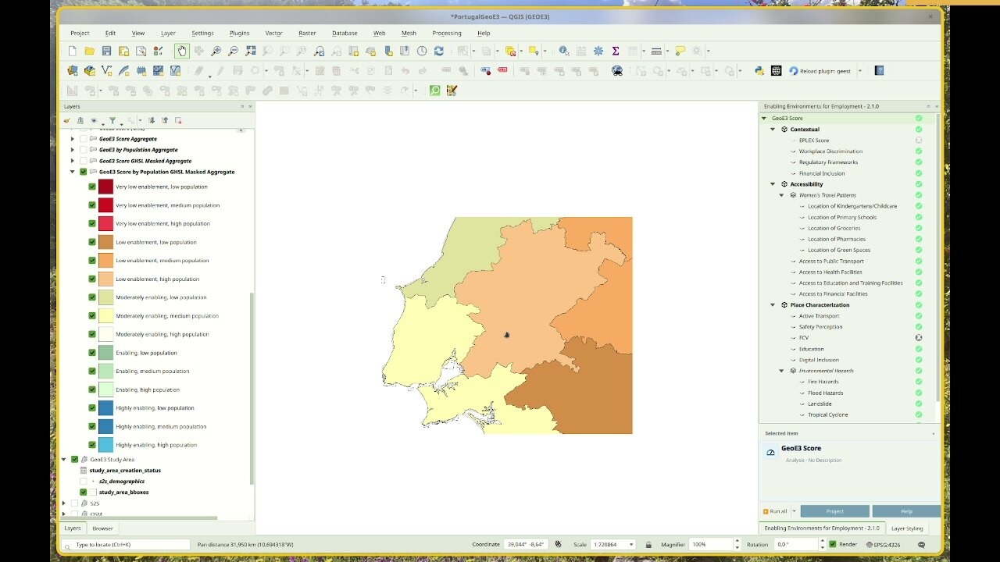

## { width="28" style="vertical-align:middle;margin-right:0.4rem;" } Viewing Your Results

!!! abstract "Learning objective"
    By the end of this page you'll be able to interpret the final GeoE3
    score, drill into any dimension, factor or indicator's methodology
    and weightings, and understand the bivariate legend that results
    from combining enablement with population density.

This page picks up once the GeoE3 Score has been configured and run (see
<a href="configuring-items.md">Configuring Items</a> for assigning dimension
weights, adding a population layer or mask, and <a href="running-the-analysis.md">Running
the Analysis</a> for actually kicking off the run). The
outputs identify regions where conditions are optimal, or at least
favorable, for women to access job opportunities in a specific sector,
highlighting key infrastructure investments that could boost women's
participation in the workforce.

Once every dimension has been processed (see the three previous pages)
and the GeoE3 Score has run, a new layer appears at the analysis node.
It's on the same [Likert scale](the-model.md#the-05-likert-scale) as
everything underneath it: red cells are very low economic enablement,
orange is low, yellow is intermediate, green is enabling, and blue is
very enabling.

<figure markdown>

<figcaption>The completed model tree, with the final GeoE3 Score on the same 0–5 scale as everything beneath it.</figcaption>
</figure>

We're able to go and explore all of the individual results as well — you
can click on any layer and you'll see a description of it at the bottom,
in the info panel (you can shrink this panel and resize it back again),
including the methodology that was used to calculate it. For example,
Workplace Discrimination uses a single factor applied equally to all
cells throughout the region.

You can go through and explore the different results generated at the
dimension level, then the factor level, and down at the indicator level —
remembering that the combination of indicators is combined into the
factor. If you double-click on a factor, you can see in a table the
weightings used to say what the relative importance of each was in the
total assessment. This is the same weights dialog covered in
[Configuring Items](configuring-items.md).

### Visualizing the Outputs
---
After completing the process, the outputs are automatically added to
the Layer Panel in QGIS as a group layer. This group layer has the
*Mutually Exclusive Group* feature activated, which ensures that only
one layer within the group can be visible at a time. When this feature
is enabled, turning on the visibility of one layer automatically turns
off the visibility of the others within the same group, making it
easier to compare results without overlapping visualizations.

The outputs consist of all GeoE3 score outputs (aggregated at
administrative level, by population, or by job distribution). The
aggregated-by-population outputs use a bivariate legend: 5 enablement
levels × 3 population tiers, 15 exact classes in total:

| Score | Class | Colour |
|---|---|---|
| 1 | Very low enablement, low population |  |
| 2 | Very low enablement, medium population |  |
| 3 | Very low enablement, high population |  |
| 4 | Low enablement, low population |  |
| 5 | Low enablement, medium population |  |
| 6 | Low enablement, high population |  |
| 7 | Moderately enabling, low population |  |
| 8 | Moderately enabling, medium population |  |
| 9 | Moderately enabling, high population |  |
| 10 | Enabling, low population |  |
| 11 | Enabling, medium population |  |
| 12 | Enabling, high population |  |
| 13 | Highly enabling, low population |  |
| 14 | Highly enabling, medium population |  |
| 15 | Highly enabling, high population |  |

{ width="65%" }

The outputs are stored within the project folder created during the
setup phase as raster files. These files can be shared and further
utilized for various purposes, such as visualization in QGIS or other
GIS software, integration into reports, overlaying with other spatial
datasets, or performing advanced geospatial analyses, such as
identifying priority areas or conducting trend analysis based on the
scores.

If the results do not immediately appear in the Layer Panel after
processing the GeoE3 Scores, you can resolve this by either adding them
manually from the folder path or by right-clicking on the GeoE3 Score
and selecting **Add to map** from the context menu.

When population and a subnational boundary layer are both configured,
**Add GeoE3 Aggregates to Map** breaks the enablement scores down by
subnational district using the same 15-class bivariate legend above —
each region shaded by its majority class, from dark red (low enablement,
low population) through to bright blue (high enablement, high
population).

<figure markdown>

<figcaption>Each subnational region shaded by its majority class — combining 5 enablement levels with 3 population tiers (low/medium/high) gives the 15 categories in the legend.</figcaption>
</figure>

There's one more advanced option worth knowing about — the subnational
score matrix — covered in [The Analysis Report](report.md) along with
the rest of what's in the PDF report.

The GeoE3 Score node has the same right-click menu as any other item
(see [The Interface](interface.md#right-click-to-interact-with-items)),
plus several score-specific **Add to Map** variants:

{ width="65%" }

| Menu item | What it does |
|---|---|
| **Add GeoE3 Score to Map** | The base 5-class enablement score |
| **Add GeoE3 by Population to Map** | The 15-class bivariate enablement × population score |
| **Add GeoE3 Aggregates to Map** | The subnational breakdown by administrative boundary |
| **Add Masked Scores to Map** | The score restricted to whatever mask you configured |
| **Add Job Opportunities Mask to Map** | The job-distribution mask, if configured |
| **Add Study Area to Map** | The study area boundary itself |

Every run also produces a full PDF analysis report, and the raw grid
results are available for export to CSV or any GIS format. Both are
covered next, in [The Analysis Report](report.md).

!!! success "Recap"
    - The GeoE3 Score combines the three dimensions you've already
      configured, weighted and run just like any other item in the tree.
    - Adding a population layer (auto-fetched from Space2Stats, or your
      own, see [WorldPop](datacollection.md#tutorial-population-data-from-worldpop))
      unlocks the 15-class bivariate legend: 5 enablement levels × 3
      population tiers.
    - Adding a subnational boundary layer breaks results down by region;
      adding a mask (GHSL settlements, or your own) restricts the
      analysis to areas you actually care about.
    - The **Subnational score matrix** setting (Settings → Options →
      GeoE3, off by default) adds a region-by-factor breakdown table to
      the PDF report.
