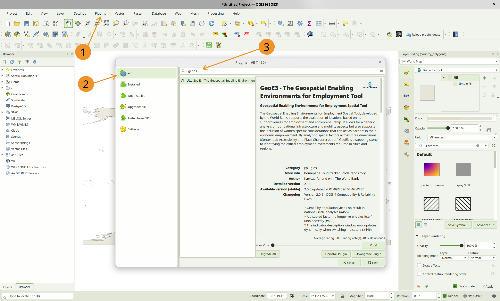

# Installing QGIS &amp; GeoE3

!!! abstract "Learning objective"
    By the end of this page you'll have a working QGIS install with the
    GeoE3 plugin enabled and visible in the toolbar.

GeoE3 runs inside [QGIS](https://www.qgis.org/en/site/) as a regular
plugin, so there's nothing to compile or configure beyond what's
covered here.

## Installing QGIS

- A recent QGIS **3.x** install (QGIS 3.28 or later is recommended).
- Internet access the first time you run an analysis, since several
  processing steps fetch open data (OpenStreetMap, population rasters,
  humanitarian data) on demand.
- Enough disk space for your study area's working files (national-scale
  analyses can use several gigabytes).

## Installing the plugin

Follow the steps below to install the GEOE3 QGIS plugin.

### Step 1: Open the Plugin Manager in QGIS

> - 1. Launch QGIS.
> - 1. Go to **Plugins** > **Manage and Install Plugins…**.

#### Step 2: Install the Plugin

> - 1. In the **Plugin Manager** window, select the **All** tab in the Plugin Manager.
> - 2. Search for `GEOE3`.
> - 3. Select the plugin and click **Install Plugin**.

<figure markdown>

<figcaption>(1) Plugins → Manage and Install Plugins…, (2) the All tab, (3) search for GEOE3.</figcaption>
</figure>

#### Step 3: Verify the Installation

> - 1. After installation, check the QGIS toolbar for the new **GEOE3** icon *Show/Hide GEOE3 Panel*.

{ width="40%" }

!!! success "Recap"
    - GeoE3 is a regular QGIS plugin, installed from the Plugin Manager.
      Search for GEOE3 under the **All** tab.
    - A toolbar icon and a dockable panel appear once it's installed and
      enabled.

Next: [The Interface](interface.md), opening the plugin, creating your
first project, and getting oriented in the model tree.
