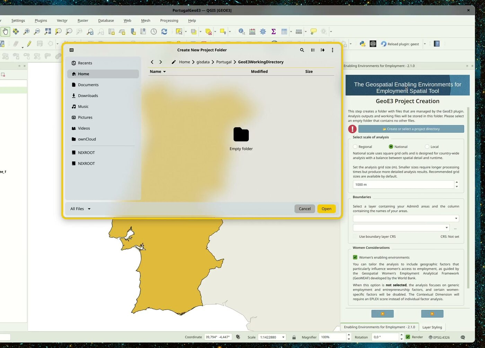

# The Interface

!!! abstract "Learning objective"
    By the end of this page you'll be able to open GeoE3, create a new
    analysis project from a boundary layer, choose the right scale for
    your study area, set up a routing environment, and read the dock's
    tree view, including the status icons and right-click menu every
    other page in this walkthrough relies on.

This page assumes you've already [installed QGIS and the GeoE3
plugin](installation.md) and have some data to work with. If not, see
[Getting Data](datacollection.md) first.

## Opening the plugin

Once installed, you'll find GeoE3's icon in the QGIS toolbar. Click it to
open the panel, which docks to the right-hand side of the window by
default.

{ width="45%" }

> 1. **Locate the Toolbar Icon**  { width="5%" }
> Find the plugin's icon in the QGIS toolbar.
>
> 2. **Open the Plugin**
> Click on the plugin's toolbar icon to open its main window.

The first page is a short welcome and overview; the next explains what
the tool does and who built it. Use the arrow buttons at the bottom of
the panel to move between pages.

<figure markdown>
{ width="35%" }
<figcaption>The welcome panel.</figcaption>
</figure>

## Opening or creating a project

Next, GeoE3 asks you to choose a project folder — every analysis lives in
its own folder, which the plugin manages for you.

{ width="45%" }

**Open an Existing Project** loads a project folder you've already set up
and configured — pick this to carry on where you left off.

**Create a New Project** walks you through setting one up from scratch,
which is what the rest of this page covers.

!!! warning
    The folder you choose must be **empty**. GeoE3 treats everything in
    it as its own — using a folder that already has other files in it can
    lead to errors or accidental overwrites. Give it a descriptive name
    (country/region plus a date is a good pattern) so you can find it
    again later.

## Creating a new project

Choose **Create a New Project**, then browse to the empty working folder
you made earlier and use that as the project folder. Then you've got
three choices to pick from to define the scale of your analysis:

| Scale    | Typical use                      | Default grid size |
|----------|-----------------------------------|--------------------|
| Regional | Quick analysis, multi-country or continental study | ~30 km (hex grid) |
| National | A single country                  | 1,000 m (1 km)     |
| Local    | A city or small region             | 100 m              |

In all three cases you can change the grid size if you want to, but the
defaults are a reasonable place to start. Regional scale also unlocks the
Space2Stats prefetch step covered in [Getting
Data](datacollection.md#tutorial-automatic-downloads-built-into-geoe3).

<figure markdown>

<figcaption>Scale, grid size, boundary layer and the Women's Enabling Environments toggle, all in one step.</figcaption>
</figure>

Then it asks for the boundary layer — point it at your Admin0 (national
boundary) layer, and tell it which column has the country name. If your
boundary layer doesn't look like the typical boundary you'd expect (it
still extends out into the ocean, for example, or is missing the level
you need), see the
[GADM](datacollection.md#tutorial-official-administrative-boundaries-from-gadm)
and
[HDX](datacollection.md#tutorial-humanitarian-data-exchange-hdx)
tutorials — OpenStreetMap's admin boundaries aren't always reliable.

The last thing it asks is whether you want to do a Women's Enabling
Environment study, or just a generic economic enabling-environment study.
Leave **Women's Enabling Environments** ticked for the
GeoWEAF-framework analysis this walkthrough demonstrates; untick it for
the generic one, and you'll get a slightly different workflow — some
women-specific factors get disabled, and the Contextual dimension needs
an EPLEX score instead of individual factor analysis.

### What happens next: the study area grid

Once you confirm, it computes a grid across the study area and writes
that into a GeoPackage file — you can see it in the study area. It
creates various different products: the main thing is the GeoPackage,
which contains a regular grid (for a regional analysis this is an H3
grid, so hexagons covering the whole study area; national and local
scale use square grid cells instead), and it also contains masks. A mask
is a raster layer which covers the study area, excluding any pixels
outside the area by giving them NoData, and including any areas inside
the study area by giving them a value of one.

{ width="45%" }

When it finishes, a **Study Area Report** opens automatically, summarizing
how many grid cells were created, how long each part of the country took
to process, and where the generated files live (your project folder's
`study_area/` subfolder). You can reopen it any time.

{ width="55%" }

### Setting up routing

The next thing it wants to do is set up the routing environment. For some
analysis steps we use a routing analysis that allows us to understand,
for example, what's the travel time for a woman to move from her home to
a clinic (or what have you) using the road network. It's possible to use
OpenRouteService for this, but you need an API key — or you can use the
native QGIS routing (`native:serviceareafromlayer`), which is a bit
slower but doesn't require any keys.

Either way, it wants to know if you've got a road network. If you've
already downloaded OSM data (see [Getting Data](datacollection.md)), you
probably don't want to use the railways — you want the roads layer. If
it's in the wrong coordinate reference system, GeoE3 will reproject it
into the correct one for you automatically. If you don't have a road
dataset, you can also click the **Download from OpenStreetMap** button
and it will fetch one for you from Geofabrik or OpenStreetMap directly.

{ width="45%" }
{ width="45%" }

## Reading the dock: a tree of dimensions, factors and indicators

Once you click through, you land on the model tree (the main working
view you'll spend most of your time in). It organises the different types
of analysis outputs into three categories, which we call **dimensions**:
the Contextual dimension, the Accessibility dimension, and the Place
Characterization dimension. Those are further subdivided into
**factors** (the second-level grouping), and each dimension may have one
or more factors associated with it.

<figure markdown>
{ width="55%" }
<figcaption>The complete model tree for a Women's Enabling Environments analysis (3 dimensions, 16 factors, 35 indicators).</figcaption>
</figure>

It's a tree in the literal QGIS-layer-panel sense: expand a dimension to
see its factors, expand a factor to see its indicators. What each of
these levels actually *means*, and how they combine, is the subject of
[The Model](the-model.md). This page is just about finding your way
around the panel itself.

<figure markdown>
{ width="45%" }
<figcaption>The data processing interface: dimensions and factors on the left, status widgets on the right.</figcaption>
</figure>

**Status widgets.** Each row in the tree shows a small icon telling you
what state that item is in:

| Status | Meaning |
|---|---|
| Configured, not run | Inputs are set up but the workflow hasn't been executed yet |
| Required, not configured | Essential inputs are still missing |
| Completed successfully | Processing finished without errors |
| Workflow failed | Something went wrong (needs troubleshooting) |
| Not configured (optional) | Optional inputs, left unset |
| Excluded from analysis | Deliberately disabled, won't be run or counted |

## Right-click to interact with items

Every item in the tree (indicator, factor, dimension or the top-level
analysis) responds to the same right-click context menu. This is how
you drive the whole tool once an item is configured:

| Menu item | What it does |
|---|---|
| **Run Item Workflow** | Executes that item's workflow, computing its output |
| **Clear Item** | Removes the item's results so you can reconfigure and rerun it |
| **Clear Results** | Clears all previously generated results |
| **Show Attributes** | Displays detailed attribute data for the item |
| **Add to Map** | Adds the item's output layer group to the QGIS Layer Panel |
| **Open Log File** | Opens the log file to review the workflow's detailed processing or errors |
| **Open Working Directory** | Opens the folder containing that item's output files |

The successful completion of a workflow is always shown by a green
checkmark status widget. If results don't automatically appear in the
Layer Panel after processing, right-click the item and choose **Add to
Map**.

!!! tip
    If an input value needs to change for any reason (an incorrect
    initial entry, say), right-click the item and choose **Clear Item**,
    then right-click it again and, while holding **Shift**, choose **Run
    Item Workflow**. This reassesses the input and outputs the corrected
    score.

**Run All** (bottom of the panel) runs every workflow regardless of
status; **Run Incomplete** only runs the ones that haven't completed yet.
The **Project** button takes you back to the setup pages above if you
need to change the scale or boundary layer later, and **Help** opens the
plugin's GitHub documentation.

Configuring every item in this tree (pointing each factor at its data,
or entering a researched national score) is exactly what [The
Model](the-model.md), [Processor Types](processor-types.md) and
[Configuring Items](configuring-items.md) walk through next.

!!! success "Recap"
    - GeoE3 projects live in their own empty folder; pick **Create a New
      Project** to start one from a boundary layer.
    - The scale you choose (regional/national/local) sets a default grid
      size and, for regional, unlocks the Space2Stats prefetch.
    - Routing for accessibility indicators defaults to QGIS's free native
      engine; OpenRouteService is faster but needs an API key.
    - The dock is a tree (dimension → factor → indicator), and every
      row has a status icon and the same right-click menu: **Run Item
      Workflow**, **Clear Item**, **Add to Map** and the rest.
