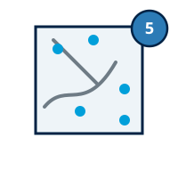
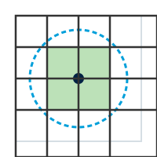
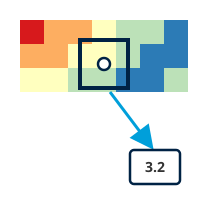

## { width="28" style="vertical-align:middle;margin-right:0.4rem;" } Place Characterization

!!! abstract "Learning objective"
    By the end of this page you'll be able to configure all seven Place
    Characterization factors, choose between the alternative data input
    options several of them offer, and understand how two of them
    (Education and Digital Inclusion) combine a national index score
    with spatial masking or coverage layers rather than raw point data.

The Place Characterization Dimension refers to the social,
environmental, and infrastructural attributes of geographical
locations, such as walkability, safety, and vulnerability to natural
hazards. Unlike the Accessibility Dimension, these factors do not
involve mobility but focus on the inherent characteristics of a place
that influence people's ability to participate in the workforce. For
more information on data input used from open sources, see [Getting
Data](datacollection.md).

Place Characterization factors span almost every [processor
type](processor-types.md): distance buffers, feature counts, published
index numbers, ready-made rasters and zone lookups all appear here, and
several factors support more than one depending on the data you give
them. Configure each one using the [generic
pattern](configuring-items.md#the-generic-pattern): double-click,
provide its data, and right-click → **Run Item Workflow** once you're
done.

### General Overview

Place Characterization factors refer to the following indicators:

- { width="18" style="vertical-align:middle;margin-right:0.3rem;" } **Active Transport:** identifies areas based on their capacity to support safe and efficient active transport (walking, cycling, and other non-motorized modes) by analyzing and categorizing the road network features downloaded during the project setup phase.
- { width="18" style="vertical-align:middle;margin-right:0.3rem;" } **Safety Perception:** defines areas perceived as safe based on specific data or, alternatively, on how brightly lit they are, assuming that brightly lit areas are safer than those with no lights.
- { width="18" style="vertical-align:middle;margin-right:0.3rem;" } **Fragility, conflict and violence (FCV):** assigns scores by analyzing overlap with ACLED data and buffers representing various types of events.
- { width="18" style="vertical-align:middle;margin-right:0.3rem;" } **Education:** computes a raster that provides a standardized measure of the percentage of people who have attained higher education within the country or region of interest. The spatial representation of education attainment is confined to inhabited areas as classified by GHS-SMOD. The default classes to be excluded from GHS-SMOD are 10 (Water grid cell) and 11 (Very low density rural grid cell).
- { width="18" style="vertical-align:middle;margin-right:0.3rem;" } **Digital Inclusion:** assesses the availability and accessibility of digital infrastructure by computing a national index score. If local statistics are available, this is used in conjunction with Ookla coverage layers, which supports the spatial representation of the data. Each Ookla polygon receives the DI score and it is further mapped to the raster cell. Raster cells that do not intersect Ookla polygons receive a score of 0 (no access).
- { width="18" style="vertical-align:middle;margin-right:0.3rem;" } **Environmental Hazards:** characterizes areas based on their vulnerability to natural disasters.
- { width="18" style="vertical-align:middle;margin-right:0.3rem;" } **Water sanitation:** assesses the availability and accessibility of clean water and sanitation facilities.

For certain factors, **multiple data input options** are available depending on the data's format and availability.

As with the Accessibility dimension, **Active transport, Safety and Water sanitation** factors can be processed according to the level of analysis—whether conducted at a broader scale, such as the **national level**, or tailored to a more localized context, such as **urban or regional** areas.

### Input Place Characterization factors

---

#### { width="22" style="vertical-align:middle;margin-right:0.4rem;" } Active Transport

{ style="float:right;width:72px;margin:0 0 0.75rem 1rem;" }

**Active Transport** refers to the availability of walkable
environments and cycling infrastructure, recognizing that people often
rely on non-motorized modes of travel for daily commutes and errands.
It is computed using the OpenStreetMap road network, where road types
are classified based on their suitability for walking and cycling.

**Locate Active Transport Section**

> - 🖱️🖱️ **Double-click** on the **Active Transport section** to open the pop-up.
> - 📝 In the *Input* field, you can select layers already loaded in the QGIS Layer Panel from the dropdown menu or manually enter the file path for the shapefiles (**point features for street crossings, lines for cycle paths and footpaths and polygons for block layout**) corresponding to the indicators by clicking the three-dot button.
> - ⚖️ **Assign Weights**: Assign appropriate weights to reflect the relative importance of each factor in the analysis. Ensure these values are consistent with your project objectives, accurately represent the significance of each factor and add up to 1 for a balanced evaluation.
> - 🚫 **Exclude Unused Factors (optional)**: If a specific factor is not intended to be included in the process, uncheck the **Use** button associated with it.
> - 🔄 **Readjust Weights**: Weight values must add up to 1 or they're shown in red. After excluding any subfactors, press **Balance Weights** to reset the remaining ones to an equal share rather than typing each value by hand.
> - ✅ **Finalize**: Once all settings are configured, click OK to confirm and proceed to the next step.

{ width="75%" }

**Active Transport** factor is calculated based on road types from OpenStreetMap as follows:
| Subfactor               | Score 0          | Score 1               | Score 2                 | Score 3                 | Score 4                 | Score 5                 |
|----------------------|------------------|-----------------------|-------------------------|-------------------------|-------------------------|-------------------------|
| **Key = highway** | bus_guideway, escape, raceway, construction and proposed roads           | motorway, motorway_link, trunk and trunk_lin                 | primary, primary_link and track                  | secondary, secondary_link, unclassified, road, bridleway and service          | tertiary and tertiary_link                    | Pedestrian, Footway, Residential, Living_street, steps           |
| **Key = cycleway**      | None             | N/A                   | N/A                     | 1 cycle path            | lane, shared_lane, share_busway, track, separate, crossing, shoulder and link                     | N/A              |

---

#### { width="22" style="vertical-align:middle;margin-right:0.4rem;" } Safety Perception

{ style="float:right;width:72px;margin:0 0 0.75rem 1rem;" }

**Safety Perception** addresses the perceived security of public
spaces, evaluated through the availability of adequate lighting, which
affects women's ability to move freely, seek employment, and access
essential services.

**Locate Safety Section**

> - 🖱️🖱️ **Double-click** on the **Safety section** to open the pop-up.
> - 📂 **Flexible Data Input Options**: Multiple data input options are available depending on the data's availability, format, or geographic coverage. Select one of the following options:
> - 1️⃣ Using **Perceived Safety data** index score as input:

{ width="55%" }

> - 2️⃣ Using **Classified Safety data** as input; select the layer already loaded in the QGIS Layer Panel from the dropdown menu or manually enter the file path for the shapefiles (**polygon features**) corresponding to the safety data by clicking the three-dot button and the classification field; this layer will be used for processing:
>
{ width="55%" }

> - 3️⃣ Using **Nighttime Lights data** as input; VIIRS Nighttime Lights raster may be used as proxy data for presence of area illumination at night time; select the layer already loaded in the QGIS Layer Panel from the dropdown menu or manually enter the file path for the (**raster data**) corresponding to NTL by clicking the three-dot button; this layer will be used for processing:
>
{ width="55%" }

> - 4️⃣ Using **Street lights data** as input; select the layer already loaded in the QGIS Layer Panel from the dropdown menu or manually enter the file path for the shapefiles (**point locations**) representing street lights by clicking the three-dot button; this layer will be used for processing:
>
{ width="55%" }

> - 🚫 **Exclude Unused Factors (optional)**: If this factor is not intended to be included in the process, uncheck the **Use** button associated with it.
> - ✅ **Finalize**: Once all settings are configured, click OK to confirm and proceed to the next step.

**Safety** is calculated by generating 20-meter buffers around streetlights using the default thresholds:

| Factor   | Score 0                | Score 1                 | Score 2                 | Score 3                 | Score 4                 | Score 5                 |
|----------|------------------------|-------------------------|-------------------------|-------------------------|-------------------------|-------------------------|
| **Safety** | No overlap            | 1-19% intersection      | 20-39% intersection     | 40-59% intersection     | 60-79% intersection     | 80-100% intersection    |

**Note:** Use nighttime light data only if streetlight data is unavailable.

---

#### { width="22" style="vertical-align:middle;margin-right:0.4rem;" } FCV

{ style="float:right;width:72px;margin:0 0 0.75rem 1rem;" }

**Fragility, conflict and violence (FCV)** considers the frequency of
events related to political unrest, conflict, and violence in a
region, which can increase people's vulnerability and limit their
access to employment and essential services.

**Locate FCV Section**

> - 🖱️🖱️ **Double-click** on the **FCV section** to open the pop-up.
> - 📂 **Flexible Data Input Options**: Multiple data input options are available depending on the data's availability, format, or geographic coverage. Select one of the following options:
> - 1️⃣ Using **Point features data** as input; select point locations representing data related to fragility, conflict and violence events; a buffer is needed to estimate the spatial impact of these events, the default radius is 5000m but if the impact radius of an event is known, it should be used instead:

{ width="55%" }

> - 2️⃣ Using **ACLED data** as input; select ACLED data in CSV format representing fragility, conflict, and violence events; this indicator is structured by assigning scores to rasters based on their overlap with buffers indicating different types of events. Using point locations of FCV events, generate circular buffers with a default radius of 5 km to estimate the spatial impact of these events. If the impact radius of an event is known, it should be used instead; a pop-up will appear to validate the CSV format.

{ width="55%" }

> - 🚫 **Exclude Unused Factor (optional)**: If this factor is not intended to be included in the process, uncheck the **Use** button associated with it.
> - ✅ **Finalize**: Once all settings are configured, click OK to confirm and proceed to the next step.

**FCV** is structured by assigning scores to raster cells based on their overlap with buffers representing different types of events. Using point locations of FCV (Fragility, Conflict, and Violence) events, create circular buffers with a radius of 5 km to estimate the spatial impact. If a specific event's impact radius is known, it should be applied instead. Raster cells intersecting with these default buffers are scored as follows:

| Factor   | Score 0              | Score 1                   | Score 2                         | Score 3             | Score 4                     | Score 5                      |
|----------|----------------------|---------------------------|---------------------------------|---------------------|-----------------------------|------------------------------|
| **FCV**  | battles and explosions | explosions and remote violence | violence against civilians |     not applicable               | protests and riots | no overlap with any event   |

---

#### { width="22" style="vertical-align:middle;margin-right:0.4rem;" } Education

{ style="float:right;width:72px;margin:0 0 0.75rem 1rem;" }

**Education** refers to the proportion of women in a region who have
attained higher education, particularly in the specific field of
analysis, serving as an indicator of societal attitudes towards women
working in that sector. The raster file is filtered by GHSL classes to
account only for areas where people live.

**Locate Education Section**

> - 🖱️🖱️ **Double-click** on the **Education section** to open the pop-up.
> - 📂 **Flexible Data Input Options**: Multiple data input options are available depending on the data's availability, format, or geographic coverage. Select one of the following options:
> - 1️⃣ Using **Index score** at the national or regional level, based on the proportion of women who have attained higher education as input:

{ width="55%" }

> - 2️⃣ Using **Classify Polygon Into Classes data** as input; select the layer already loaded in the QGIS Layer Panel from the dropdown menu or manually enter the file path for the shapefiles (**polygon features**) corresponding to the education data by clicking the three-dot button then, select the classification field to be used for processing:

{ width="55%" }

> - 🚫 **Exclude Unused Factor (optional)**: If this factor is not intended to be included in the process, uncheck the **Use** button associated with it.
> - ✅ **Finalize**: Once all settings are configured, click OK to confirm and proceed to the next step.

**Education** reclassifies the input data to a standardized scale from 0 to 5 using a linear scaling process. In this scale, a *score of 5* represents areas where all women have a university degree, while a *score of 0* represents areas where no women have a university degree.

---

#### { width="22" style="vertical-align:middle;margin-right:0.4rem;" } Digital Inclusion

{ style="float:right;width:72px;margin:0 0 0.75rem 1rem;" }

**Digital Inclusion** assesses the presence of digital infrastructure
in a specific location, which is essential for women to pursue job
opportunities, access training and education opportunities, and use
financial services. This dataset is masked using the Ookla dataset, to
account for areas where internet coverage has been mapped and exclude
inhabited areas.

**Locate Digital Inclusion Section**

> - 🖱️🖱️ **Double-click** on the **Digital Inclusion section** to open the pop-up.
> - 📂 **Flexible Data Input Options**: Multiple data input options are available depending on the data's availability, format, or geographic coverage. Select one of the following options:
> - 1️⃣ Using **Index score** at the national or regional level, based on the proportion of available digital infrastructure as input:

{ width="55%" }

> - 2️⃣ Using **Classify Polygon Into Classes data** as input; select the layer already loaded in the QGIS Layer Panel from the dropdown menu or manually enter the file path for the shapefiles (**polygon features**) corresponding to the digital inclusion data by clicking the three-dot button then, select the classification field to be used for processing:

{ width="55%" }

> - 🚫 **Exclude Unused Factor (optional)**: If this factor is not intended to be included in the process, uncheck the **Use** button associated with it.
> - ✅ **Finalize**: Once all settings are configured, click OK to confirm and proceed to the next step.

**Digital Inclusion** reclassifies input data to a standardized scale of 0 to 5 using a linear scaling process, where *5* represents areas where 100% of households have internet access, and *0* represents areas where no households have internet access.

---

#### { width="22" style="vertical-align:middle;margin-right:0.4rem;" } Environmental Hazards

{ style="float:right;width:72px;margin:0 0 0.75rem 1rem;" }

**Environmental Hazards** relate to the impact of environmental risks,
such as floods, droughts, landslides, fires and extreme weather events,
which can disrupt job stability, particularly for women in vulnerable
sectors.

This factor is composed, by default, of five subfactors representing
different types of hazards: fires, floods, landslides, tropical
cyclones and droughts. These subfactors are aggregated into a single
factor, referred to as Environmental Hazards, based on the selected
weights assigned to each subfactor.

If data for one or more hazard types is not available, these subfactors
can be excluded from the processing. In such cases, the tool will
automatically adjust the weights of the remaining subfactors to ensure
accurate aggregation.

The thresholds for defining hazard levels are based on a predefined
scoring list. The input data relies on globally available open data
sources and is reclassified for use within the tool. However, if more
precise and localized data is available, users are encouraged to
incorporate it into the processing. In doing so, users should align the
data with the thresholds provided to maintain consistency and
reliability.

**Locate Environmental Hazards Section**

> - 🖱️🖱️ **Double-click** on the **Environmental Hazards section** to open the pop-up.
> - 📝 In the *Input* field, you can select layers already loaded in the QGIS Layer Panel from the dropdown menu or manually enter the file path for the **raster features** corresponding to the indicators by clicking the three-dot button.
> - ⚖️ **Assign Weights**: Assign appropriate weights to reflect the relative importance of each factor in the analysis. Ensure these values are consistent with your project objectives, accurately represent the significance of each factor and add up to 1 for a balanced evaluation.
> - 🚫 **Exclude Unused Factors (optional)**: If a specific factor is not intended to be included in the process, uncheck the **Use** button associated with it.
> - 🔄 **Readjust Weights**: Weight values must add up to 1 or they're shown in red. After excluding any subfactors, press **Balance Weights** to reset the remaining ones to an equal share rather than typing each value by hand.
> - ✅ **Finalize**: Once all settings are configured, click OK to confirm and proceed to the next step.

{ width="55%" }

**Environmental Hazards** reclassifies input data to a standardized scale of 0 to 5 using a linear scaling process, where *5* represents areas with no environmental hazards and *0* represents areas with the highest level of hazard.

| Factor                                   | Class 0            | Class 1              | Class 2              | Class 3              | Class 4              | Class 5              |
|------------------------------------------|--------------------|----------------------|----------------------|----------------------|----------------------|----------------------|
| **Number of Fires per km²**              | >8                 | 5–8                  | 2–5                  | 1–2                  | 0–1                  | 0 or No Data         |
| **Floods Data**                          | 720–900 cm         | 540–720 cm           | 360–540 cm           | 180–360 cm           | <180 cm              | No Data or 0         |
| **Landslide Data**                       | Severe             | High-Moderate2 (4)   | Moderate (3)         | Low-Moderate1 (2)    | Slight (1)           | No Data or 0         |
| **Tropical Cyclone Frequency (100 Years)** | >100 events        | 75–100 events        | 50–75 events         | 25–50 events         | <25 events           | No Data or 0         |
| **Drought Data**                         | 4–5                | 3–4                  | 2–3                  | 1–2                  | 0–1                  | No Data or 0         |

---

#### { width="22" style="vertical-align:middle;margin-right:0.4rem;" } Water sanitation

{ style="float:right;width:72px;margin:0 0 0.75rem 1rem;" }

**Water sanitation** concerns the availability of clean water and
sanitation facilities, affecting women's time allocation and capacity
to engage in employment. It is captured indirectly, by accounting for
the spatial distribution of facilities whose operation depends on
reliable water supply and sanitation services. The presence of these
points of interest suggests the existence of minimum water and
sanitation infrastructure necessary for service delivery, even where
direct household level data are unavailable.

**Locate Water sanitation Section**

> - 🖱️🖱️ **Double-click** on the **Water sanitation section** to open the pop-up.
> - 📝 In the *Input* field, you can select layers already loaded in the QGIS Layer Panel from the dropdown menu or manually enter the file path for the shapefiles (**point features**) corresponding to the points of interest by clicking the three-dot button; a buffer is needed to estimate the spatial impact of these facilities, the default radius is set to 1000 meters; however, this value can be adjusted based on the user's considerations.
> - 🚫 **Exclude Unused Factor (optional)**: If this specific factor is not intended to be included in the process, uncheck the **Use** button associated with it.
> - ✅ **Finalize**: Once all settings are configured, click OK to confirm and proceed to the next step.

{ width="55%" }

**Water Sanitation** is assessed based on the presence of water related features within a raster cell, applying a default 3000m buffer. The scoring is as follows:

| Factor                  | Score 0                   | Score 1 | Score 2 | Score 3                     | Score 4 | Score 5                        |
|-------------------------|---------------------------|---------|---------|-----------------------------|---------|--------------------------------|
| **Water Sanitation**    | outside the 3km buffer          | N/A     | N/A     | N/A               | N/A     | intersection with the 3km buffer         |

---

Once every factor has its data, double-click the **Place
Characterization** dimension and follow the same [generic
pattern](configuring-items.md#the-generic-pattern) as every other item
in the tree: assign weights, balance them, and run it.

{ width="75%" }

The outputs (all seven factors and their subfactors, plus their
aggregation into the final Place Characterization score) land in the
Place Characterization folder within your project folder, on the usual
[0–5 enablement scale](the-model.md#the-05-likert-scale).

!!! success "Recap"
    - Place Characterization has seven factors; most take point, line or
      polygon OSM-style data, but Education and Digital Inclusion are
      driven by a national index score combined with a spatial mask or
      coverage layer, closer in spirit to the Contextual factors.
    - Several factors (Safety Perception, Active Transport, Water
      sanitation) offer more than one input option. Pick whichever
      matches the data you actually have.
    - Results combine into a single Place Characterization output on the
      usual 0–5 enablement scale.
