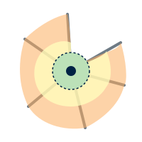
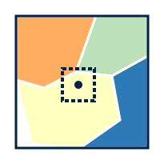
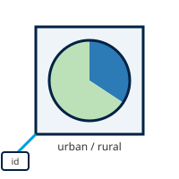
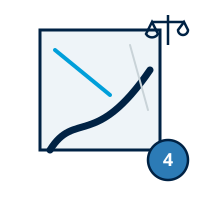

# Processor Types

!!! abstract "Learning objective"
    By the end of this page you'll be able to recognise which of GeoE3's
    computation techniques any given indicator uses, and why that
    determines what kind of data it needs from you.

Every indicator needs to go from whatever raw data it starts with to a
0–5 enablement score for every cell in the grid (see [The
Model](the-model.md) for why that common scale matters). How it gets
there depends on which technique the indicator uses. These are the same
techniques the PDF analysis report explains in its own Methodology
section.

## National Index Score

<figure markdown>

</figure>

Some of what this analysis measures doesn't change from one part of the
country to another. Whether the law formally protects women from
workplace discrimination, for instance, is set in national legislation:
it's true (or not) everywhere at once, down to the last village. For
indicators like this, every grid cell is given the same score, taken
directly from a published index. A couple of the indicators that work
this way are narrowed further, scored only where the underlying data
actually applies (only where broadband coverage exists, say, or only
inside built-up settlements). Everywhere else is left blank, rather than
attaching a labour-force statistic to land where nobody lives, or an
internet-use figure to a place the coverage data never reached.

**Used by**: Workplace Discrimination, Regulatory Frameworks, Financial
Inclusion, EPLEX Score (Contextual); Digital Inclusion, Education,
Safety Perception when given an index score (Place Characterization).

## Feature Count

<figure markdown>

</figure>

For some indicators, what matters is simply how much of something sits
inside each cell of the grid (the number of clinics, say, or the total
length of footpaths and cycle lanes running through it). This technique
overlays the grid on the real-world data and tallies how many points,
lines or polygons fall inside each cell. The score isn't a smooth slide
from that count: a cell with nothing nearby scores 0, a cell with
exactly one feature scores a middle mark, and a cell with two or more
already scores the maximum. A single clinic is enough to lift a cell out
of the bottom of the scale; a second one maxes it out.

**Used by**: Active Transport, at regional and local scale (Place
Characterization).

## Straight-Line Distance

<figure markdown>

</figure>

Other indicators are less about density and more about proximity. Can a
woman reach a water point without travelling far, or has a violent
incident happened nearby? This technique draws a fixed-radius circle
around every relevant point, measured as the crow flies rather than
along any real path, and scores a grid cell by whether it falls inside
that circle or outside it. Being inside the circle is good news for a
water point or a bank branch, and bad news for a reported violent
event. Whether "inside" means a high score or a low one depends on what's
being measured, not on the technique itself.

**Used by**: FCV, Safety Perception when given street-light points,
Water Sanitation (Place Characterization).

## Distance by Road

<figure markdown>

</figure>

For indicators about reaching a service, such as a school, a hospital,
or a bus stop, a straight-line circle overstates how accessible a place
really is: rivers, dead-end streets and missing roads all make a
destination further away in practice than it looks on a map. Rather
than measuring as the crow flies, this technique traces the actual road
network outward from each facility in several steps (for example a 5-,
10- and 15-minute walk) and scores a grid cell by which travel-time
ring it falls inside. The resulting shape hugs the street layout rather
than forming a tidy circle. A facility beside the only bridge over a
river, for example, reaches much further along the road than it does
across the water.

**Used by**: all five Accessibility factors (Women's Travel Patterns,
Access to Public Transport, Health Facilities, Education and Training
Facilities, Financial Facilities).

## Map Value Lookup

<figure markdown>

</figure>

Some of the data this analysis draws on arrives as a finished map rather
than a set of points or lines (a satellite-derived picture of
night-time brightness, say, or a hazard model showing flood risk across
the whole country). For indicators like these, there's no counting or
buffering to do: each grid cell simply reads off the value already
present at that location, the same way you'd read a figure off a weather
map by pointing at a city. A brightly lit area scores well on the
night-time-lights indicator (used here as a rough proxy for how safe a
place feels after dark); a high-risk zone scores poorly on a hazard
indicator.

**Used by**: Environmental Hazards (fire, flood, landslide, cyclone,
drought) and Safety Perception when given VIIRS nighttime-lights data.

## Zone Lookup

<figure markdown>

</figure>

A small number of indicators come from boundary data rather than points,
lines or a continuous map (a layer of named zones, each carrying its own
attribute, such as a safety rating reported by residents). This
technique works out which zone a grid cell falls inside, looks up that
zone's attribute value in a conversion table, and assigns the matching
0–5 score to every cell inside it. Two cells a street apart can end up
with very different scores if they happen to sit on opposite sides of a
zone boundary: the result is only ever as fine-grained as the zones it
was collected in.

**Used by**: Digital Inclusion, Education and Safety Perception, when
given a classified polygon layer instead of an index score or point
data (Place Characterization).

## Population Share

<figure markdown>

</figure>

Occasionally the figure an indicator needs has already been calculated
by somebody else and handed over pre-matched to this analysis's own
grid (the share of a cell's population living in an urban versus a
rural settlement, say, taken from aggregated census-style data). There's
no spatial join or buffering left to do: the value is simply attached to
the matching grid cell by a shared location key, then rescaled onto the
0–5 scale.

**Used by**: Education, when backed by Space2Stats' urban/rural split
(Place Characterization).

## Weighted Infrastructure Score

<figure markdown>

</figure>

National-scale Active Transport scores a cell differently from every
other indicator on this page: rather than taking the single best road or
cycle path running through it, every road and cycle path intersecting
the cell contributes its own score, weighted by that same score (a
well-rated cycle lane counts several times more than a poorly-rated
track). A cell crossed by one excellent route and nothing else no longer
scores as if it were uniformly excellent, but a cell genuinely dominated
by good infrastructure still scores close to the top; a cell with only
poor infrastructure stays low even if a single short, better-rated
segment clips its edge. Regional and local scale still use the
single-best-feature technique described above (Feature Count).

**Used by**: Active Transport, at national scale only (Place
Characterization).

## Several factors offer more than one technique

Which technique an indicator actually uses often depends on what data
you give it. Safety Perception, for instance, can be driven by an index
score, street-light points, VIIRS nighttime-lights, or a classified
polygon layer, each scored by a different technique above. The
[dimension walkthroughs](contextual.md) that follow spell out exactly
which inputs each factor accepts.

!!! success "Recap"
    - Every indicator uses one of these techniques to turn raw data into
      a 0–5 score: a single published number, counting nearby features,
      distance to the nearest one, travel time along the road network, a
      ready-made raster value, a zone lookup, a pre-matched demographic
      figure, or (Active Transport only, at national scale) a
      weighted average across every intersecting feature.
    - Several factors support more than one technique; pick whichever
      matches the data you have.
    - The PDF analysis report's own Methodology section explains
      whichever of these techniques your analysis actually used.
