# The Analysis Report

!!! abstract "Learning objective"
    By the end of this page you'll know how to navigate every section of
    the PDF analysis report GeoE3 generates after every run, what each
    page is actually telling you, and how to read the correlation and
    subnational score matrix pages.

Alongside producing all the different outputs, we also get a PDF report
that gets produced. You can pull that up at any time by right-clicking
the analysis node and saying **Show Analysis Report** — it will take a
few minutes to generate. This report is a summary of the entire
analysis: it tries to cover the high-level results, then describe the
methodology, and then provide some more detailed analysis results. The
examples on this page are real pages from a Regional-scale Women's
Enabling Environments analysis of Portugal.

## Credits

It starts off with the credits and attribution: the partners that
funded the plugin, and the data attribution for the different data
sources we used (OpenStreetMap, OpenRouteService, GHSL, Ookla,
Space2Stats, ACLED, VIIRS Nighttime Lights, and whatever you supplied
yourself).

<figure markdown>
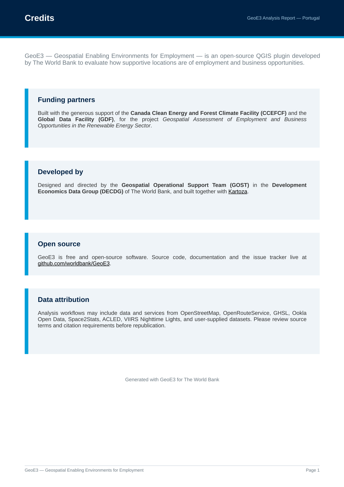{ width="85%" }
<figcaption>Funding partners, who built it, and exactly which data sources contributed to this run.</figcaption>
</figure>

## Reading the Maps

Then we describe the legend (the five classes that are key to
understanding the different visualizations we produce), using the same
0–5 scale covered in [The Model](the-model.md#the-05-likert-scale). It
also explains what a blank cell means (outside the study area, or no
data) versus an actual score of 0: the measured service is genuinely
out of reach, e.g. a cell with no road network access.

<figure markdown>
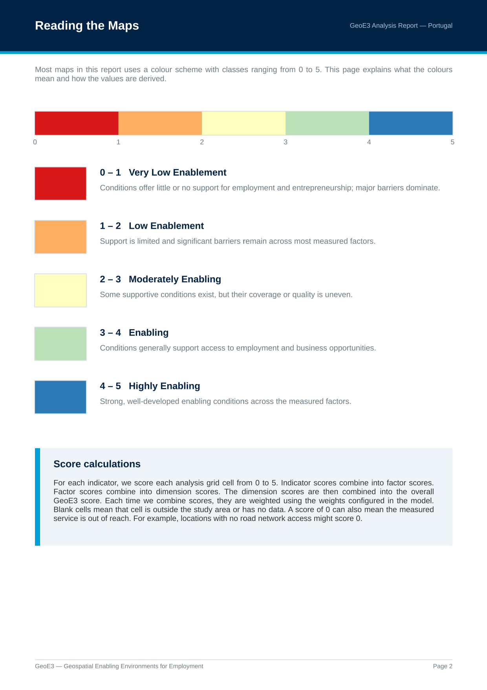{ width="85%" }
<figcaption>Very Low Enablement through Highly Enabling, with a one-line description of what each class means in practice.</figcaption>
</figure>

## Reading the By-Population Maps

We also have a legend that's used for describing places where results
are combined with population — high-density population with low
enablement through to high enablement with low density of population —
the same 15-class bivariate legend covered on [Viewing Your
Results](insights.md).

<figure markdown>
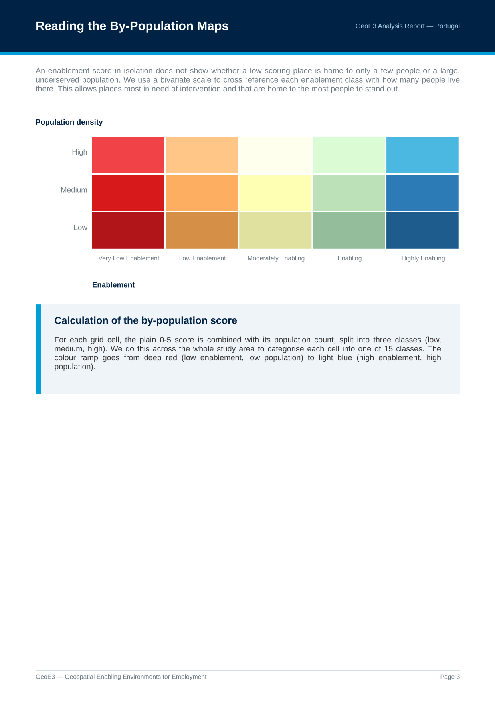{ width="85%" }
<figcaption>The colour ramp runs from deep red (low enablement, low population) to light blue (high enablement, high population).</figcaption>
</figure>

## Analysis Overview

Then it goes through and shows each of the outputs that got generated.
You can see the proportion of cells in the analysis which conform to
each of the different enablement classes. In this Portugal run, most of
the country sits in moderate enablement, with some areas high and some
low.

<figure markdown>
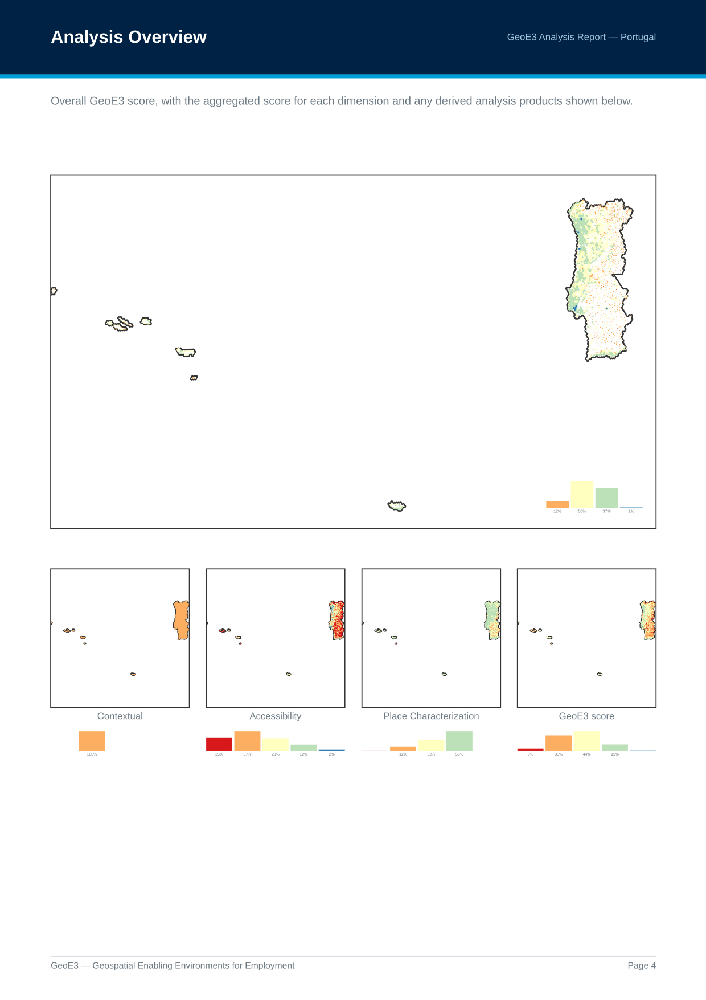{ width="85%" }
<figcaption>Overall GeoE3 score across mainland Portugal, Madeira and the Azores, plus the three dimension aggregates underneath.</figcaption>
</figure>

## Every Dimension and Factor

We walk through each of the different dimensions in detail. The
Contextual dimension factors all come out the same colour across the
whole map, because these are flood-filling the whole country with the
same value, based on whatever legal framework is in place.

<figure markdown>
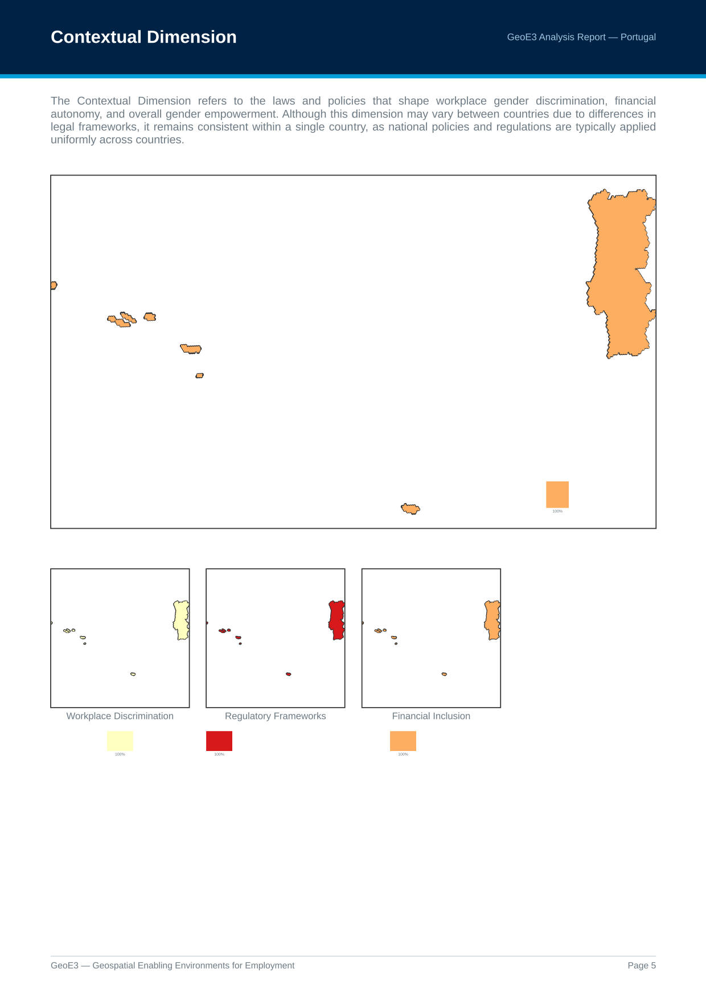{ width="85%" }
<figcaption>The Contextual Dimension page: Workplace Discrimination, Regulatory Frameworks and Financial Inclusion, each a single flat national score. Accessibility and Place Characterization follow the same per-dimension, then per-factor, pattern, each with its own page.</figcaption>
</figure>

You can see the breakdown per dimension: very few places score low
enablement from high crime or high natural-disaster levels, but there
are quite a lot of places with poor accessibility (the red parts
toward the sides of the country).

If you configured an aggregation boundary (see [Configuring
Items](configuring-items.md)), you then get subnational breakdown maps
too: the GeoE3 score by administrative region, the same masked by GHSL
settlements, and both of those again combined with population. These
are the same products available from **Add GeoE3 Aggregates to Map** on
[Viewing Your Results](insights.md).

## The Subnational Score Matrix

One other thing worth knowing: if you go into **Settings → Options →
GeoE3**, there's a box you can tick, **Subnational score matrix**. It's
an advanced option and it's not on by default — turning it on gets you
an additional table in the report, every region and its scoring against
every factor, that gives you a way to visualize the economic environment
across all the different subnational boundaries and quickly pick out
interesting factors.

<figure markdown>
{ width="85%" }
<figcaption>The table identifies factors by number rather than name, so keep this key page handy, or an aggregation boundary table that maps your region codes to their friendly names.</figcaption>
</figure>

<figure markdown>
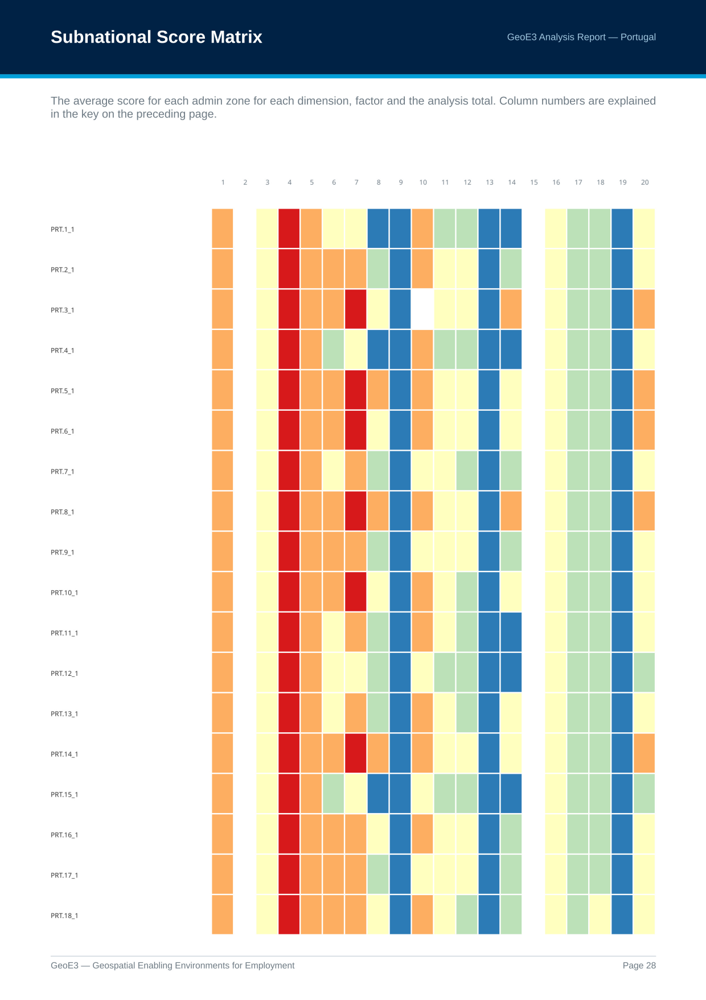{ width="85%" }
<figcaption>In this Portugal example run, one factor was red for every single region — that turned out to be a Contextual factor (Regulatory Frameworks, column 4) set to a low value for the whole country. Column 15 (FCV) sits blank throughout: no ACLED or proxy data was supplied for this run, so that factor was excluded rather than scored.</figcaption>
</figure>

## Factor Score Patterns

Then you get all of the scores as sparklines, or as charts, in one page
that you can view together and pick out any ones where there's
particularly high values on one side or the other.

<figure markdown>
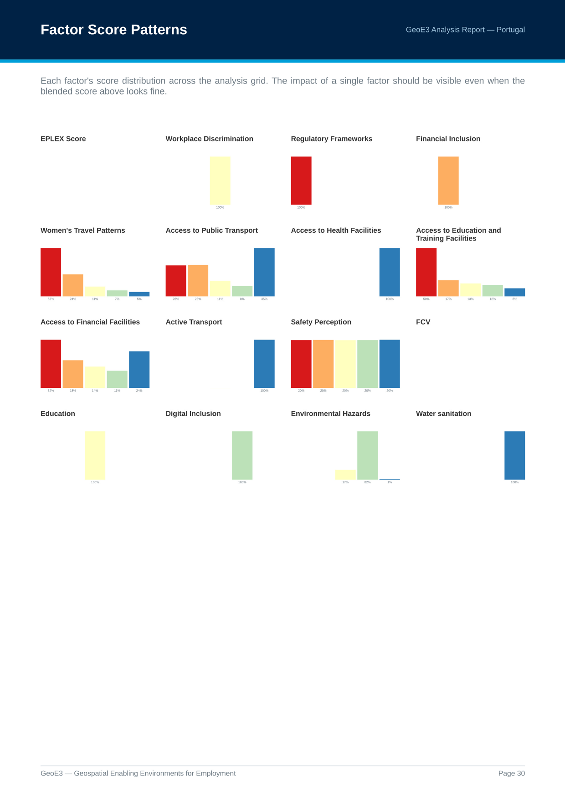{ width="85%" }
<figcaption>There's probably fairly good transport networks in Portugal, good access to health facilities, training is maybe not so good, and access to financial has got some good areas and some bad areas. Factors driven by a flat national score show a single 100% bar, since a national score has no spatial variation to spread across classes.</figcaption>
</figure>

## Low Scores

Then there are some insights: which thing has the biggest ability to
improve your access to economic environment? In this Portugal run,
Accessibility was the highest one there, the dimension most often
limiting a low-scoring cell.

<figure markdown>
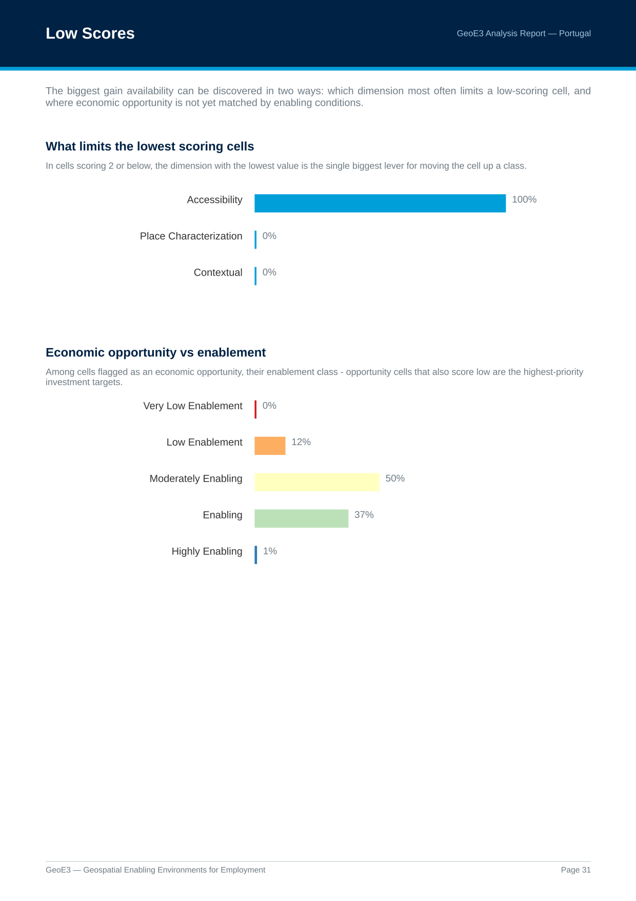{ width="85%" }
<figcaption>In cells scoring 2 or below, Accessibility was the limiting dimension 100% of the time: distance to services, not legislation or place characteristics, is the single biggest lever for raising those cells a class.</figcaption>
</figure>

And then there's a part of the analysis that lets you see what the
average scores are across the whole study area versus just the areas
that are populated.

<figure markdown>
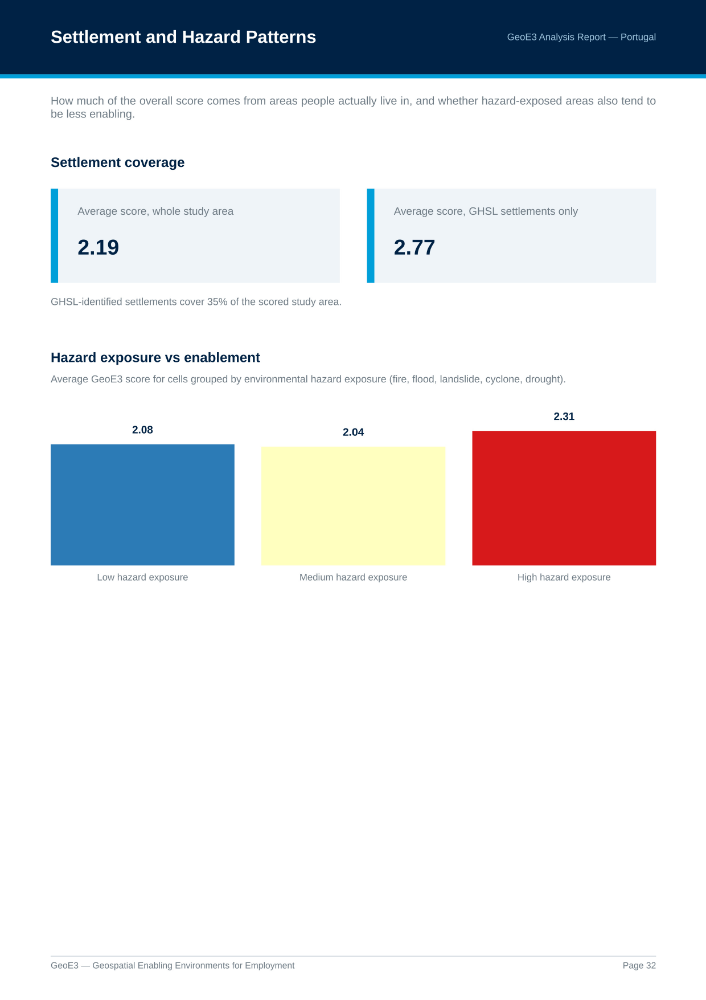{ width="85%" }
<figcaption>GHSL settlements cover 35% of the scored study area here and average a noticeably higher score (2.77) than the study area as a whole (2.19). Enablement is concentrated where people actually live.</figcaption>
</figure>

## Factor Correlations

There's also an interesting visualization here showing the correlation
between factors. If we look at the axis on 13 to 5, there's a negative
correlation: environmental hazards and access to public transport
negatively impact each other. If we look at the positive side, for
example 4 to 10, women's travel patterns and safety perception
positively impact each other, so women can travel more comfortably if
they've got good safety perception.

<figure markdown>
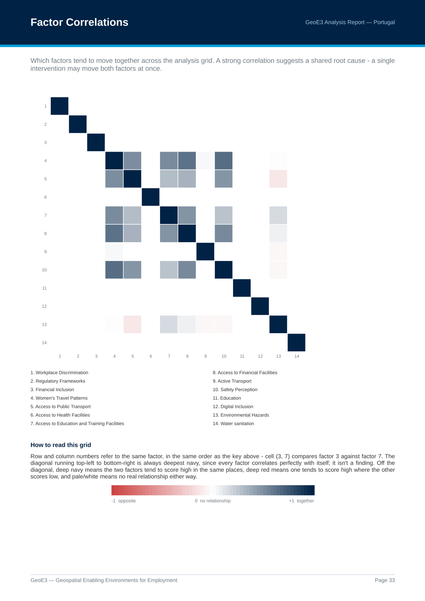{ width="85%" }
<figcaption>Deep navy means the two factors tend to score high in the same places; deep red means one tends to score high where the other scores low; pale or white means no real relationship. The diagonal is always deepest navy (a factor always correlates perfectly with itself) and isn't a finding.</figcaption>
</figure>

A strong correlation suggests a shared root cause: a single
intervention may move both factors at once.

## Methodology

Then we have a diagram explaining the methodology: taking indicators,
weighting them together to form factors, then weighting those factors
into dimensions, then weighting the dimensions into the final GeoE3
score (the same cascade covered in [The Model](the-model.md)). All of
the analysis methodology processes are explained in the report too: the
Contextual dimension where we fill every cell with the same value,
counting features in a cell, buffer analysis, the network analysis that
works out a facility's catchment area along the road network, and
reading a value straight off an existing map. See [Processor
Types](processor-types.md) for the full set, and which indicators in
your own analysis used each one.

## Scoring Weights

All the weights used in the analysis are listed here. Starting from the
bottom of a dimension's list: in this Portugal run, Active Transport is
assigned 17% of the analysis within Place Characterization, alongside
five other factors at 17% each; together they all contribute 45%
toward the total global result.

<figure markdown>
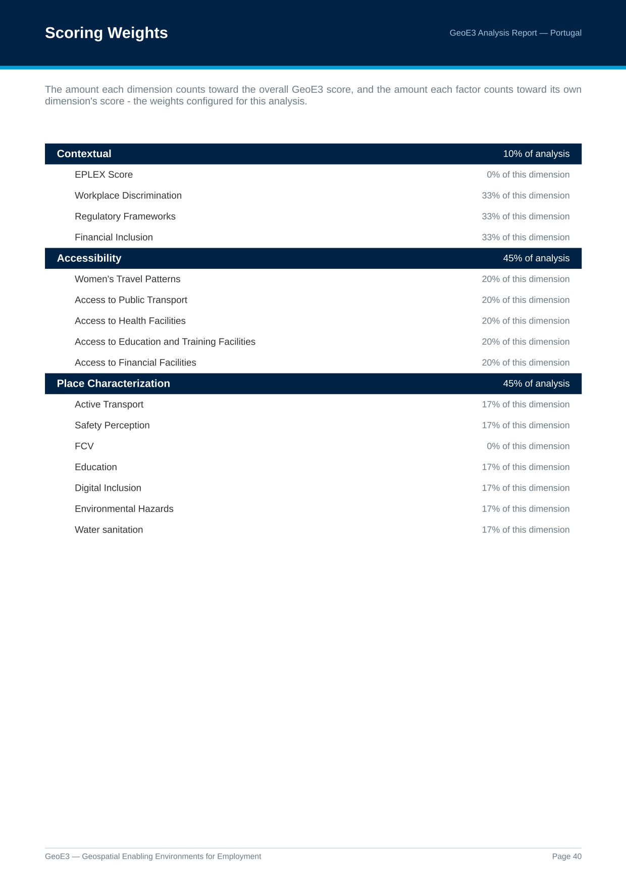{ width="85%" }
<figcaption>Notice EPLEX and FCV both sit at 0% here: excluded factors still get listed, at zero weight, rather than disappearing from the report.</figcaption>
</figure>

## Processing Times

Then the last page has some processing time information. This is
useful if you want to go and optimize things, or understand why
something isn't running as quickly as you'd like.

<figure markdown>
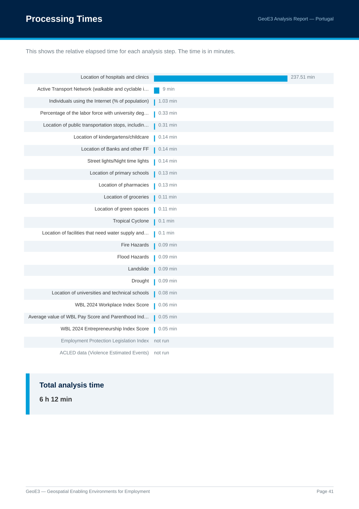{ width="85%" }
<figcaption>Network-isochrone indicators dominate the clock. "Location of hospitals and clinics" alone took almost 4 hours in this regional-scale Portugal run, versus under a minute for most national-score and raster-lookup indicators. Indicators with no data supplied are listed as "not run" rather than omitted.</figcaption>
</figure>

There are also some notes about the scale and number of grid cells and
the region used for the analysis.

<figure markdown>
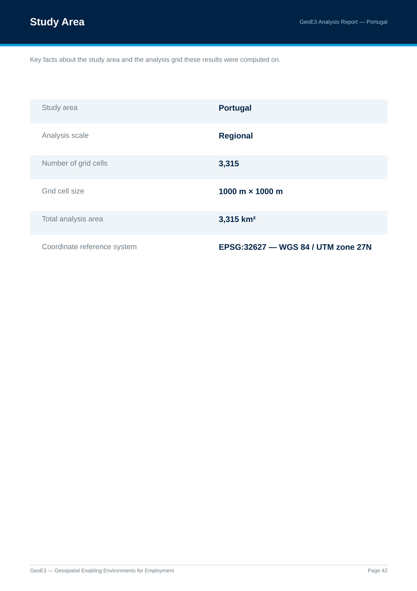{ width="85%" }
<figcaption>Country, scale, number of grid cells, cell size, total area, and the coordinate reference system used.</figcaption>
</figure>

That's the basics of it, and the real thing you're ultimately getting
at the end of the process is the GeoE3 score map, which shows the
economic enablement of each cell.

!!! success "Recap"
    - **Show Analysis Report** on the analysis node generates a full PDF:
      credits and legends, every output with its distribution,
      subnational breakdowns, a factor correlation heatmap, and the
      methodology and weights actually used.
    - The correlation heatmap: navy means two factors move together, red
      means they move in opposite directions, pale means no real
      relationship.
    - The **Subnational score matrix** setting (Settings → Options →
      GeoE3, off by default) adds a key page plus a region-by-factor
      colour grid. A column that's one solid colour everywhere is almost
      always a flat national (Contextual) score, not a mistake.
    - Factor Score Patterns, Low Scores, and Settlement and Hazard
      Patterns surface things the blended dimension and GeoE3 scores can
      smooth over, worth a look even when the headline map looks fine.

Next: [Sharing Your Results](sharing.md), getting the raw grid out of
QGIS and into a spreadsheet, CSV or other GIS software.
