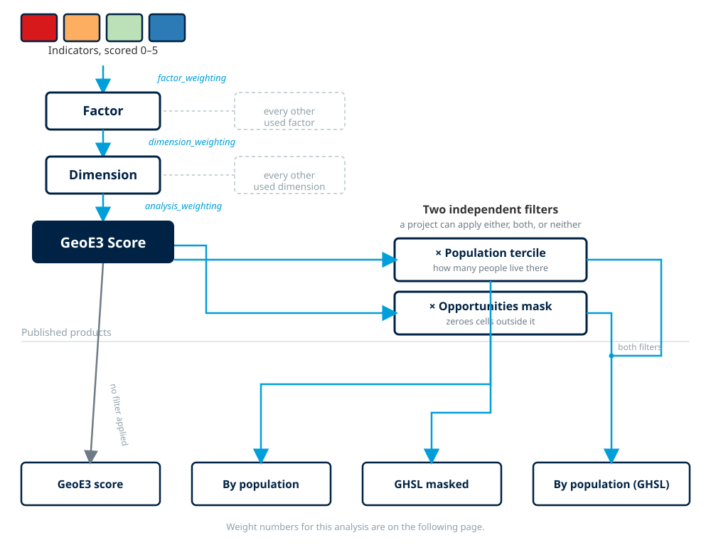

# The Model

!!! abstract "Learning objective"
    By the end of this page you'll understand the four levels of the
    GeoE3 model (indicator, factor, dimension and analysis), how
    weights aggregate one level into the next, and why every score, at
    every level, lands on the same 0–5 Likert scale.

## Indicators, factors, dimensions and analysis

The model tree you met on [The Interface](interface.md) page organises
every output into three categories, which we call **dimensions**: the
Contextual dimension, the Accessibility dimension and the Place
Characterization dimension. Those are further subdivided into
**factors** (the second-level grouping), and each dimension may have
one or more factors associated with it.

- **Dimensions**: there are 3 (Contextual, Accessibility, Place
  Characterization), the broadest grouping, each with its own weight in
  the final score.
- **Factors**: there are 16 across the three dimensions, the themes
  you'll configure one by one (e.g. Workplace Discrimination, Women's
  Travel Patterns, Active Transport).
- **Indicators**: there are 35 in total, the actual calculated layers.
  Most factors are a single indicator. A couple of them (Women's Travel
  Patterns and Environmental Hazards) expand into five indicators each:
  childcare, schools, groceries, pharmacies and green space for the
  former; fire, flood, landslide, cyclone and drought for the latter.

Every grid cell in an analysis has a score from 0 to 5 for each
indicator, combined into factor, dimension and overall scores. This is
the same diagram the PDF report opens its Methodology section with:

<figure markdown>

<figcaption>Indicators → Factor → Dimension → GeoE3 Score, each step combined by a weight you assign. The population and opportunities-mask filters on the right are covered in <a href="configuring-items.md">Configuring Items</a>.</figcaption>
</figure>

Every level of that cascade works the same way: you assign a weight to
each child item, and the tool combines them into its parent's score.

- **Indicators → Factor**: a factor's indicators are combined using the
  weights you assign them (most factors have only one indicator, so this
  step is invisible; Women's Travel Patterns and Environmental Hazards
  are the exceptions, each combining five).
- **Factors → Dimension**: each dimension's factors are weighted and
  combined the same way. Double-click a dimension to see and change
  those weights.
- **Dimensions → Analysis**: the three dimensions are weighted and
  combined into the final GeoE3 Score, the same pattern one level up
  again.

Whenever you change a weight, the total of the weight values must add
up to one. If it doesn't, the weight values are shown in red and you
can't confirm the dialog. If you want to assign every enabled item an
equal weight, press **Balance Weights** rather than typing each value
by hand. This applies the same way whether you're balancing indicators
within a factor, factors within a dimension, or dimensions within the
analysis. The mechanics of
opening an item's dialog, setting weights, excluding items you don't
have data for, and running the workflow are covered once, generically,
in [Configuring Items](configuring-items.md), since they're the same
regardless of which level of the tree you're working on.

## The 0–5 Likert scale

Every indicator, factor, dimension and the final analysis score all land
on the same scale: each cell gets a score of enabling or not enabling,
on a scale of 0 to 5 (blue is enabling, red is not enabling). This is
the same 5-class legend used to colour every result layer in the plugin:

| Score | Class | Colour |
|---|---|---|
| 0 – 1 | Very Low Enablement |  |
| 1 – 2 | Low Enablement |  |
| 2 – 3 | Moderately Enabling |  |
| 3 – 4 | Enabling |  |
| 4 – 5 | Highly Enabling |  |

When you run the final analysis, the result comes through in this same
Likert scale: red cells are very low economic enablement, orange is low,
yellow is intermediate, green is enabling, and blue is very enabling.

<figure markdown>

<figcaption>The completed model tree, with the final GeoE3 Score on the same 0–5 scale as everything beneath it.</figcaption>
</figure>

Rescaling every indicator onto the same 0–5 range (whether the
underlying data was a percentage, a distance in metres, a travel time,
or a published index score out of 100) is what makes it valid to combine
completely different kinds of data into one number. How each indicator
actually gets converted onto that scale depends on what kind of data it
starts from. That's the subject of the next page, [Processor
Types](processor-types.md).

!!! success "Recap"
    - Four levels: **indicator → factor → dimension → analysis**. Each
      level combines its children using weights you assign, the same way
      every time.
    - At any level, the weights must add up to one (shown in red if they
      don't). **Balance Weights** resets every enabled item to an equal
      share rather than normalising whatever you'd typed in.
    - Every score, at every level, lands on the same 0–5 enablement
      scale: 0–1 Very Low Enablement through to 4–5 Highly Enabling.
