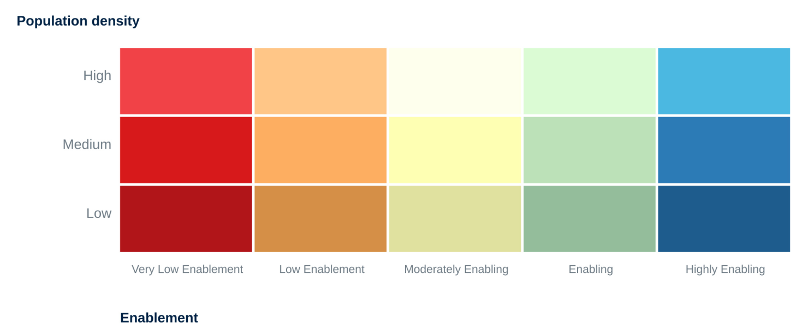

# 2-Hour Workshop Guide

!!! abstract "Learning objective"
    A single-page, paint-by-numbers run-of-show for the GeoE3 hands-on
    workshop: every step, in order, cross-linked to the full detail on
    each page in this walkthrough. Print it, or work through it on a
    second screen next to QGIS.

This page condenses the full [Training Walkthrough](index.md) into a
2-hour, follow-along session. It assumes you're working through it live
(solo or in a group) rather than reading cover to cover — each section
links back to the full page for anything that needs more detail than
fits here.

A branded slide deck and presenter notes for running this as a live
session are available in the repository's `docs/presentations/`
directory: `geoe3-training-session.md` (Marp slides, also exported as
PDF and PPTX) and `TRAINING-SESSION-PRESENTER-NOTES.md`.

## Before You Start

- [ ] QGIS **3.x** installed (3.28 or later recommended)
- [ ] GeoE3 plugin installed (**Plugins → Manage and Install Plugins…**,
  search `GEOE3`) — see [Installation](installation.md)
- [ ] Internet access for the session
- [ ] An **empty** folder ready to use as your project folder
- [ ] A country or region in mind for your analysis

## Running Order (~120 minutes)

| # | Segment | Time | Detail page |
|---|---|---|---|
| 1 | The Interface — open, create a project, the study area grid | 15 min | [The Interface](interface.md) |
| 2 | The Model & Processor Types | 10 min | [The Model](the-model.md), [Processor Types](processor-types.md) |
| 3 | Getting Data | 10 min | [Getting Data](datacollection.md) |
| 4 | Configuring Items — the one pattern | 10 min | [Configuring Items](configuring-items.md) |
| 5 | Contextual Dimension | 10 min | [Contextual Dimension](contextual.md) |
| 6 | Accessibility Dimension | 10 min | [Accessibility Dimension](accessibility.md) |
| 7 | Place Characterization Dimension | 10 min | [Place Characterization Dimension](placecharacterization.md) |
| 8 | Running the Analysis (+ stretch break while it runs) | 10 min | [Running the Analysis](running-the-analysis.md) |
| 9 | Viewing Your Results | 10 min | [Viewing Your Results](insights.md) |
| 10 | The Analysis Report | 5 min | [The Analysis Report](report.md) |
| 11 | Sharing Your Results | 5 min | [Sharing Your Results](sharing.md) |
| 12 | Wrap-up & Q&A | 5 min | — |

## 1 · The Interface (15 min)

> - 1. Click the **GeoE3** toolbar icon, step through the welcome pages
> - 2. Choose **Create a New Project**, point it at your empty folder
> - 3. Pick a scale (**Regional**, **National**, or **Local**) — defaults
>      are fine
> - 4. Select your **Admin0 boundary layer** and its name column
> - 5. Leave **Women's Enabling Environments** ticked
> - 6. Wait for the **study area grid** to build — the Study Area Report
>      opens automatically when it's done

**Checkpoint**: your project is created, the grid finished, and you can
find a status icon on any row in the model tree.

## 2 · The Model & Processor Types (10 min)

Four levels — **indicator → factor → dimension → analysis** — each
combining its children by weight into the parent's score. Every score,
at every level, lands on the same **0–5 enablement scale**. The
technique each indicator uses to get there (national index, feature
count, distance buffer, network isochrone, and four more) is explained
once, generically, on [Processor Types](processor-types.md) — no action
needed here beyond reading along.

## 3 · Getting Data (10 min)

Three ways data gets in: **fully automatic** (download buttons in an
indicator's dialog, or the Space2Stats prefetch at Regional scale),
**open datasets you fetch yourself** (Geofabrik, GADM, HDX, WorldPop),
and **manual national-index entry** for the Contextual indicators.

## 4 · Configuring Items (10 min)

> - 1. **Double-click** an item to open its dialog
> - 2. **Point it at data** (indicators only)
> - 3. **Assign Weights** (factors/dimensions/analysis) — must sum to 1
> - 4. **Untick Use** for anything you don't have data for
> - 5. **Balance Weights** to redistribute evenly
> - 6. Click **OK**
> - 7. **Right-click → Run Item Workflow** — green check = success

**Checkpoint**: you've configured and run at least one item using this
exact pattern.

## 5 · Contextual Dimension (10 min)

All four factors (Workplace Discrimination, Regulatory Frameworks,
Financial Inclusion, EPLEX/WBL) use the **National Index Score**
technique: one researched number, typed in once. Configure at least one
factor using the pattern from Step 4, then double-click **Contextual**
itself to set the factor weights.

## 6 · Accessibility Dimension (10 min)

Five factors (Women's Travel Patterns, Access to Public Transport,
Health Facilities, Education and Training Facilities, Financial
Facilities), all using network-isochrone analysis over OpenStreetMap
data. Pick one travel mode (walking or driving) and use it consistently
across all five. Configure at least one factor.

## 7 · Place Characterization Dimension (10 min)

Seven factors (Active Transport, Safety Perception, FCV, Education,
Digital Inclusion, Environmental Hazards, Water Sanitation). Configure
at least one — Environmental Hazards is a good worked example, since it
has five sub-indicators (fire, flood, landslide, cyclone, drought) that
demonstrate excluding what you don't have data for.

## 8 · Running the Analysis (10 min, includes a break)

> - 1. Click **Run All** (or **Run Incomplete** if some items are still
>      unconfigured)
> - 2. Leave it running in the background — a full run can take a while
> - 3. ☕ **Take 10 minutes** while it processes
> - 4. If interrupted (crash, restart): reopen the project and click
>      **Run Incomplete**, not **Run All**, to pick up where it left off

## 9 · Viewing Your Results (10 min)

The output group has **Mutually Exclusive Group** on, so only one
result shows at a time. If results don't appear automatically,
right-click **GeoE3 Score → Add to map**. If you supplied a population
layer, explore **GeoE3 by Population** — the 15-class bivariate legend
(5 enablement levels × 3 population tiers):

<figure markdown>
{ width="55%" }
<figcaption>Enablement reads across, population density reads down.</figcaption>
</figure>

**Checkpoint**: your GeoE3 Score layer is on the map, and you can
explain the bivariate legend to someone else.

## 10 · The Analysis Report (5 min)

Right-click the analysis node → **Show Analysis Report** (takes a few
minutes). Skim the Credits, Reading the Maps, Analysis Overview, every
Dimension/Factor page, and the Factor Correlations heatmap — deep navy
means two factors move together, deep red means they move oppositely,
pale means no relationship.

## 11 · Sharing Your Results (5 min)

Export the vector **GeoE3 Score** layer's attribute table to **CSV**
for use outside QGIS. **Bundle Input Data to GeoPackage** packages the
whole project (inputs, results, the model) into one file a colleague
can rebuild with **Import a Country Pack**.

## 12 · Wrap-Up & Q&A (5 min)

**The full pipeline, one line**: install → create project (study area
grid) → configure every indicator/factor/dimension → run all → interpret
(score map, bivariate legend, PDF report) → share (CSV, country pack).

Didn't finish configuring every factor live? That's fine — this guide
and the full [Training Walkthrough](index.md) stay up to date at
**worldbank.github.io/GeoE3** for finishing afterward.

!!! success "Recap"
    - One pattern, every level of the tree: double-click, configure,
      weight, exclude what you lack data for, balance, OK, run.
    - The study area grid (Step 1) is the foundation every output in
      every later step is calculated against.
    - **Run Incomplete**, not **Run All**, after any interruption —
      progress saves after every item.
    - The bivariate legend reads enablement across, population density
      down. A blank cell is not the same as a score of zero.
